# YuanWork — 任务拆解（目标态）

<!-- SDD:SPEC:tasks -->

## 0. 元信息

| 项目 | yuanwork |
|------|------|
| 版本 | v0.1 |
| 关联文档 | proposal.md, design.md |
| 任务总数 | 79 |
| 执行策略 | 按里程碑推进；每个里程碑结束跑一次全量回归与验收回放 |
| 批次 | M25 |

## 1. 任务列表

### M1 地底：工作域、锚点、隐私与错误语义

### [x] TASK-001: 实现工作域条目表与增删查接口

- **描述**: 新增工作域条目表（路径、类型、是否纳入索引、加入时间），提供加入文件夹与单个文件、列出条目、移除条目的接口；解析管线改为遍历工作域条目
- **输入**: `yuanwork/db/sqlite.py`、`yuanwork/ingestion/pipeline.py`
- **输出**: 工作域表与 `Workspace` 模块，工作域路由的 4 个端点
- **验收标准**: 覆盖 AC-F-001、AC-F-002、AC-E-001、AC-E-002、AC-E-003、AC-E-004、AC-E-005、AC-E-006、AC-E-012
- **依赖**: 无
- **验证命令**: `.venv/Scripts/python.exe -m pytest src/backend/tests/unit/test_workspace_contract.py -q`
- **验证结果**: 21 passed（2026-11-14）；全量回归后端 1053 passed / Rust 42 passed / 前端 62 passed。旧测试按新规范同步更新：端点清单 24→28（新增 workspace 组 4 个端点）、标签组 7→8、提示词模板 4→5（新增空库拒答文案）、schema 表 11→12 / 索引 16→17

### [x] TASK-002: 实现可扩展的位置锚点结构并迁移五类锚点

- **描述**: 用一个含类型与坐标的锚点结构替换固定的三个定位列，让 PDF、PPT、Word、Excel、Markdown 各自产出对应锚点
- **输入**: `yuanwork/memory/semantic.py`、六个解析器、`yuanwork/utils/chunk_meta.py`
- **输出**: 锚点结构与其在各解析器中的产出，以及一条只加列不回填的迁移
- **验收标准**: 覆盖 AC-F-003、AC-E-007
- **依赖**: TASK-001
- **验证命令**: `.venv/Scripts/python.exe -m pytest src/backend/tests/unit/test_anchor_contract.py -q`
- **验证结果**: 17 passed（2026-11-14）；全量回归后端 1071 passed / Rust 42 passed / 前端 62 passed。旧测试按新规范同步更新：向量表 16→14 列（page/slide_number/section 三列换成 anchor 一列）、迁移字段数、Excel 由整表一块改为按行出块、章节与标题路径现在也算位置

### [x] TASK-003: 修复切块丢弃短切片的问题

- **描述**: 去掉最小 50 字符的过滤，改为把过短的切片并入相邻切片，保证原文内容不丢
- **输入**: `yuanwork/ingestion/chunker/structural_chunker.py`
- **输出**: 切块器的合并逻辑
- **验收标准**: 覆盖 AC-F-002、AC-E-002、AC-E-003
- **依赖**: 无
- **验证命令**: `.venv/Scripts/python.exe -m pytest src/backend/tests/unit/test_storage_contract_chunker.py -q`
- **验证结果**: 11 passed（2026-11-14）；全量回归后端 1082 passed。过短的切片改为并入相邻切片（放得下才并，放不下就单独保留），文档末尾的短句不再丢失；旧测试里「短切片被丢弃」的两条断言改为「不丢内容」

### [x] TASK-004: 审计条目改为只存元数据与哈希

- **描述**: 审计条目去掉提问与回答原文，改为提示词哈希、长度、令牌数与耗时；同步修订隐私文档的承诺表述
- **输入**: `yuanwork/privacy/audit.py`、`yuanwork/llm/gateway.py`、`docs/privacy.md`
- **输出**: 新的审计条目结构与文档修订
- **验收标准**: 覆盖 AC-F-019
- **依赖**: 无
- **验证命令**: `.venv/Scripts/python.exe -m pytest src/backend/tests/unit/test_privacy_contract_audit_entry.py -q`
- **验证结果**: 15 passed（2026-11-14）；全量回归后端 1086 passed。审计条目改为 `prompt_hash` + `prompt_length` + 令牌数 + 耗时 + `error_kind`（失败只记类别不记异常原文）；`log_llm_call` 的参数里不再有能接收原文的地方；`docs/privacy.md` 与 `docs/architecture.md` 的承诺表述同步修订，偏差表里那条「保存了提问与回答前 200 字符」已删除

### [x] TASK-005: 接入脱敏，使片段发往模型前先脱敏

- **描述**: 在构造回答提示词与冲突判定输入之前对证据片段做脱敏；修掉实体抽取提示词里的花括号占位符问题；补一个脱敏开关配置
- **输入**: `yuanwork/privacy/redactor.py`、`yuanwork/orchestrator/steps/answer.py`、`yuanwork/wiki/entity_extractor.py`
- **输出**: 脱敏接线、开关配置、抽取提示词的模板修正
- **验收标准**: 覆盖 AC-F-019
- **依赖**: 无
- **验证命令**: `.venv/Scripts/python.exe -m pytest src/backend/tests/unit/test_privacy_contract_redaction_wiring.py -q`
- **验证结果**: 11 passed（2026-11-14）；全量回归后端 1097 passed。脱敏在**发往模型前**生效（回答提示词 + 冲突判定），本地存储与引用显示的仍是原文；新增开关 `YUANWORK_ENABLE_REDACTION`（默认开启）；实体抽取提示词的 JSON 示例花括号已转义，模型路径第一次真正跑通（顺带容忍模型直接返回数组）

### [x] TASK-006: 收敛错误响应，不再回显内部异常原文

- **描述**: 全局异常处理器与问答端点改为返回错误码与用户可读文案，异常原文只进本地日志
- **输入**: `yuanwork/api/app.py`、`yuanwork/api/routes/chat.py`
- **输出**: 统一错误响应结构
- **验收标准**: 覆盖 AC-E-005、AC-E-009
- **依赖**: 无
- **验证命令**: `.venv/Scripts/python.exe -m pytest src/backend/tests/unit/test_api_contract_errors.py -q`
- **验证结果**: 17 passed（2026-11-14）；全量回归后端 1103 passed。新增 `api/errors.py` 统一错误体（`error` + `code`）；全局处理器、阻塞与流式问答端点不再回显异常原文；模型失败与「证据不足」用 `refusal_reason` 区分（`model_unavailable` vs `low_confidence`），文案也不同

### [x] TASK-007: 实现摄取任务状态落库

- **描述**: 把摄取任务状态从进程内存字典迁到关系库的既有任务表，提供状态回收；启动时清理遗留的运行中任务
- **输入**: `yuanwork/api/routes/ingest.py`、`yuanwork/db/sqlite.py`
- **输出**: 任务状态的持久化读写
- **验收标准**: 覆盖 AC-P-005
- **依赖**: 无
- **验证命令**: `.venv/Scripts/python.exe -m pytest src/backend/tests/unit/test_api_contract_ingest_kb.py -q`
- **验证结果**: 16 passed（2026-11-14）；全量回归后端 1105 passed / Rust 42 / 前端 62。任务状态落到 `ingest_jobs` 表（新增 `current_file` 列并带老库的加列迁移）；写入是「未提及的字段保持原值」，不会把进度抹掉；启动时清理遗留的运行中任务；提供已完成任务的回收

### [x] TASK-008: 实现网络守卫拦截本机代理隧道

- **描述**: 网络守卫在放行本机地址的同时，拦截显式配置为代理的连接，堵住「本机代理隧道全部外网流量」的绕过面
- **输入**: `yuanwork/privacy/network_guard.py`
- **输出**: 代理识别的匹配规则
- **验收标准**: 覆盖 AC-F-019
- **依赖**: 无
- **验证命令**: `.venv/Scripts/python.exe -m pytest src/backend/tests/unit/test_privacy_contract_bypass.py -q`
- **验证结果**: 14 passed（2026-11-14）；全量回归后端 1112 passed。守卫读 `http_proxy`/`https_proxy`/`all_proxy`（含大写形式）得到代理目标，连接这些目标即抛 `NetworkIsolationError(reason="proxy_tunnel")`；只写主机不写端口的代理拦该主机全部端口；本机其他端口仍放行（本地模型不受影响）；未覆盖的绕过面（`getaddrinfo`、`connect_ex`、子进程）继续在文档与测试中显式钉住

### M2 检索与证据闸：可信地回答或拒答

### [x] TASK-009: 实现证据充分性判定的硬规则闸

- **描述**: 新增证据闸的硬规则部分：证据条数达阈、每条证据都能定位到原文位置；任一不满足即判定为不通过
- **输入**: `yuanwork/retrieval/confidence.py`、新增的证据闸模块
- **输出**: 证据闸的硬规则判定与判定结果结构
- **验收标准**: 覆盖 AC-F-007、AC-E-007、AC-E-008、AC-E-011
- **依赖**: TASK-002
- **验证命令**: `.venv/Scripts/python.exe -m pytest src/backend/tests/unit/test_evidence_gate_hard_rules.py -q`
- **验证结果**: 31 passed（2026-11-14）；全量回归后端 1143 passed / Rust 42 / 前端 62。新增 `yuanwork/retrieval/evidence_gate.py`：`check_hard_rule()` 判「条数 ≥ 2 且每条证据都能定位到原文位置」（定位用 TASK-002 的锚点，5 类锚点与旧的三列回退都算定位得到），`EvidenceGate.evaluate()` 出设计 §3.1 的判定结果（`passed`/`hard_rule_ok`/`model_ok`/`reason`/`sufficient_count`）。证据闸成为独立步骤并接进编排层（阻塞与流式两条路径都走），拒答原因改为 `insufficient_evidence` / `unlocatable_evidence`。原置信度打分器的单一数值阈值不再参与是否作答的判断（设计 §6 的「重做」），分数只作为给用户看的信号保留；模型自评闸留到 TASK-010 接入，硬规则不过时不再调用模型

### [x] TASK-010: 实现证据充分性判定的模型自评闸

- **描述**: 新增证据闸的模型自评部分：让模型判断这些证据能否回答该问题；调用失败按不通过处理
- **输入**: 新增的证据闸模块、模型网关
- **输出**: 模型自评闸的提示词与判定逻辑
- **验收标准**: 覆盖 AC-F-008、AC-E-008、AC-P-004
- **依赖**: TASK-009
- **验证命令**: `.venv/Scripts/python.exe -m pytest src/backend/tests/unit/test_evidence_gate_model.py -q`
- **验证结果**: 22 passed（2026-11-14）；全量回归后端 1165 passed / Rust 42 / 前端 62。新增 `yuanwork/retrieval/model_gate.py` 与 `orchestrator/prompts/evidence_gate.j2`：模型以 JSON 回答「这些证据够不够回答这个问题」，只依据证据判断、不许用自己的知识补足；读不出结论、解析失败、调用失败一律按不通过处理。「模型不可用」与「证据不足」分开记原因（设计 §4.3），文案也不同：前者说模型暂时不可用并保留证据位置，后者说没找到足够明确的证据。硬规则已判不通过时不再调用模型；等待有上限（`DEFAULT_GATE_TIMEOUT`）；闸门判定耗时写进 trace，可实测（AC-P-004 的预算要在真实供应商上量）

### [x] TASK-011: 实现拒答输出：最可能位置与改进建议

- **描述**: 拒答分支改为输出最可能相关的位置与改进建议（怎么改问法、怎么补文档），不给出未经证据支持的结论；位置用使用者读得懂的表述（文件名 + 页码或章节名），不用内部标识
- **输入**: `yuanwork/orchestrator/steps/answer.py`
- **输出**: 拒答模板与渲染逻辑
- **验收标准**: 覆盖 AC-F-009
- **依赖**: TASK-009
- **验证命令**: `.venv/Scripts/python.exe -m pytest src/backend/tests/unit/test_llm_contract_refusal_citation.py -q`
- **验证结果**: 22 passed（2026-11-14）；全量回归后端 1176 passed / 前端 62 / Rust 42。拒答位置改从**证据**取（带页码/章节/表行），候选文件只作兜底；措辞按拒答原因分开（证据不足 / 证据定位不到 / 模型判定证据不足 / 模型不可用），第一条建议随原因变，其余三条固定；拒答文案由模板渲染、不经过模型，所以不会夹带未经证据支持的结论；内部标识（切片 id、文档 id、路径）不出现在文案里

### [x] TASK-012: 实现回答步骤的引用校验

- **描述**: 解析答案里的引用编号，剔除未被引用的证据；出现越界编号或解析不出时转拒答
- **输入**: `yuanwork/orchestrator/steps/answer.py`、`yuanwork/orchestrator/agent.py`
- **输出**: 引用校验逻辑与失败时的拒答分支
- **验收标准**: 覆盖 AC-F-005、AC-F-020
- **依赖**: TASK-002
- **验证命令**: `.venv/Scripts/python.exe -m pytest src/backend/tests/unit/test_citation_validation.py -q`
- **验证结果**: 20 passed（2026-11-14）；全量回归后端 1196 passed / 前端 63 / Rust 42。新增 `validate_citations()`：解析答案里的 `[n]`（也认 `[1,2]` 与 `[1][2]`，非数字的方括号不算引用），编号越界或一个引用都没有即转拒答（原因 `citation_invalid`）；引用列表只保留答案真正用到的证据，但编号保持原样（答案里的 `[3]` 仍对应引用 3），避免用户拿错出处核对。流式路径同样校验：文本已经发出无法收回，改为用拒答文案替换并保留证据引用

### [x] TASK-013: 实现冲突判定并把答案改写为以知识库为准

- **描述**: 独立判定模型答案与知识库是否冲突；冲突时以知识库内容改写答案，模型原答作为对照附在后面，并在开头标注分歧；判定失败时仍按知识库作答且不泄漏模型认知
- **输入**: `yuanwork/consolidation/conflict.py`、`yuanwork/orchestrator/agent.py`
- **输出**: 冲突判定结果结构与答案改写逻辑、冲突记录写入
- **验收标准**: 覆盖 AC-F-010、AC-F-011、AC-E-009、AC-E-010、AC-P-004
- **依赖**: TASK-012
- **验证命令**: `.venv/Scripts/python.exe -m pytest src/backend/tests/unit/test_conflict_rewrite.py -q`
- **验证结果**: 14 passed（2026-11-14）；全量回归后端 1210 passed / 前端 63 / Rust 42。`detect_conflict` 失败时返回 `failed: true`（不再与「没有冲突」混为一谈）；新增 `rewrite_with_knowledge_base()`：冲突时答案正文换成知识库原文 + 顶部标注分歧 + 模型原答作为「仅作对照」附在后面（ADR-010）；**判定失败时同样按知识库作答但不附模型原答**（没被核对过的说法没资格当结论，AC-E-010）。冲突记录补齐设计 §3.1 要求的字段：`conflicts` 表加 `topic` 与 `citation` 两列（带老库加列迁移），记录分歧点、双方说法、出处与判定说明

### [x] TASK-014: 配置融合权重并重新标定

- **描述**: 把稠密与稀疏的融合权重从硬编码常量改为配置项，并按融合分的实际区间重新标定置信度的归一化项
- **输入**: `yuanwork/retrieval/hybrid.py`、`yuanwork/retrieval/confidence.py`、`yuanwork/config.py`
- **输出**: 配置项与重新标定后的公式
- **验收标准**: 覆盖 AC-F-004、AC-P-002
- **依赖**: 无
- **验证命令**: `.venv/Scripts/python.exe -m pytest src/backend/tests/unit/test_retrieval_contract_confidence.py -q`
- **验证结果**: 13 passed（2026-11-14）；全量回归后端 1212 passed / 前端 63 / Rust 42。新增配置项 `YUANWORK_FUSION_ALPHA` / `YUANWORK_FUSION_BETA`（两者必须相加为 1.0，否则启动即报错）；检索器不再写死 0.65/0.35，而是读配置。置信度的两个归一化项按**融合分的实际区间**重标：融合分 = alpha×稠密 + beta×全文，两路各自按自身最大值归一，所以最好的一条命中落在「只有一路找到」（较大权重）到「两路都找到」（权重之和）之间——归一化区间即 `[max(alpha,beta), alpha+beta]`，标定区间与生产口径对齐了（ADR-006）

### [x] TASK-015: 限制检索链路的超时上限

- **描述**: 给向量库调用、嵌入模型推理与全文检索各加超时上限，通道不可用时按设计降级
- **输入**: `yuanwork/retrieval/hybrid.py`、`yuanwork/memory/semantic.py`
- **输出**: 超时配置与降级分支
- **验收标准**: 覆盖 AC-F-004、AC-P-002
- **依赖**: 无
- **验证命令**: `.venv/Scripts/python.exe -m pytest src/backend/tests/unit/test_retrieval_contract_edges.py -q`
- **验证结果**: 17 passed（2026-11-14）；全量回归后端 1217 passed / 前端 63 / Rust 42。三处各加超时上限（配置项 `YUANWORK_DENSE_TIMEOUT_SECONDS` / `YUANWORK_SPARSE_TIMEOUT_SECONDS` / `YUANWORK_EMBEDDING_TIMEOUT_SECONDS`）：向量库调用与嵌入推理原来还**阻塞事件循环**，现在都放进线程并加 `asyncio.wait_for`。降级按设计 §4.3：全文通道超时 → 降级为纯稠密（查询照常作答）；稠密通道或嵌入超时 → **整体失败并报错**，不静默返回空

### [x] TASK-016: 接线或删除失效配置项

- **描述**: 逐项判定 15 个声明但未被读取的配置项：接线的接线、删除的删除，并同步修订环境变量样例文件的注释
- **输入**: `yuanwork/config.py`、`.env.example`
- **输出**: 生效的配置项与修订后的样例文件
- **验收标准**: 覆盖 AC-F-020
- **依赖**: 无
- **验证命令**: `.venv/Scripts/python.exe -m pytest src/backend/tests/unit/test_runtime_contract_validation.py -q`
- **验证结果**: 22 passed（2026-11-14）；全量回归后端 1217 passed / 前端 63 / Rust 42。15 项逐项判定：**删除 4 项**（`workers` 本应用单进程；`per_session_max_tokens` / `per_query_max_tokens` / `monthly_cap_usd` 目标态没有承诺预算，留着只是骗人）；**接线 11 项**：`embedding_batch_size`（嵌入批大小）、`reranker_model` + `use_reranker`（交叉编码器，默认**改为关**：568 MB 磁盘 + 1.2 GB 内存 + 首次 5-30 秒，CPU 机器上会吃掉首个问题的全部延迟预算）、`top_k_initial` + `top_k_rerank`（召回规模）、`confidence_threshold_high/low`（分数档位）、`enable_episodic_memory`（关掉则不建情景记忆/画像库/整合层，聊天照常可用）、`enable_wiki_auto_compile`（关掉则不自动编译页面）、`reflection_trigger_turns` / `reflection_trigger_idle_minutes`（整合触发判定，`ConsolidationEngine.should_trigger()`）。另：首阶段召回规模不再随重排开关变化（`max(top_k, top_k_initial)`），否则关掉重排会让全文通道的召回变窄、融合变差。新增测试「每个声明的配置项都有人读」——以后再出现失效配置会直接失败

### M3 记忆工程：情景事件、语义实体、整合

### [x] TASK-017: 定义情景事件表与记录接口

- **描述**: 新增情景事件表（发生时刻、会话标识、事件类型、主体、细节、重要度），提供记录与按时间、主题、对象检索的接口
- **输入**: `yuanwork/db/sqlite.py`、新增的情景记录模块
- **输出**: 情景事件表与记录接口
- **验收标准**: 覆盖 AC-F-016
- **依赖**: 无
- **验证命令**: `.venv/Scripts/python.exe -m pytest src/backend/tests/unit/test_episodic_event_contract.py -q`
- **验证结果**: 17 passed（2026-11-14）；全量回归后端 1234 passed / 前端 63 / Rust 42。新增 `episodic_events` 表（与既有 `episodes` 对话表分开：前者记「发生了什么」，后者记「说了什么」）与 `memory/episodic_recorder.py` 的 `EpisodicRecorder`（对应设计 §1.1 的模块名）：六类事件（提问/引用/采纳/否定/增文件/删文件）由数据库 CHECK 约束把关，未知类型不记；发生时刻带时区的 ISO 8601；可按时间、主题、对象、会话、类型检索（可组合），最新在前。写失败只记日志不抛错——一次记不下来的交互不该把交互本身弄坏

### [x] TASK-018: 接入六类交互事件到提问链路

- **描述**: 在提问、引用、采纳或否定、增删工作域文件这 6 个动作点记录情景事件
- **输入**: `yuanwork/orchestrator/agent.py`、工作域模块、情景记录模块
- **输出**: 6 个记录点的接线
- **验收标准**: 覆盖 AC-F-016
- **依赖**: TASK-001, TASK-017
- **验证命令**: `.venv/Scripts/python.exe -m pytest src/backend/tests/unit/test_episodic_wiring.py -q`
- **验证结果**: 13 passed（2026-11-14）；全量回归后端 1247 passed / 前端 63 / Rust 42。六个记录点都接上了：**提问**在编排层（理解之后记，主题取自理解结果；被拒答的问题也算一次提问）、**增文件/删文件**在工作域路由（加文件夹与加单文件都算增）、**引用/采纳/否定**由客户端上报（新端点 `POST /api/v1/interactions/{kind}`，只认这三种类型，其余 422）。记录器在启动时装配；关掉记忆工程层（`YUANWORK_ENABLE_EPISODIC_MEMORY=false`）时端点照常返回、不记也不报错

### [x] TASK-019: 实现语义实体与关系的存储

- **描述**: 新增语义实体与实体关系的存储，含别名、属性、提及次数与来源情景事件列表
- **输入**: `yuanwork/db/sqlite.py`
- **输出**: 实体与关系表及读写方法
- **验收标准**: 覆盖 AC-F-015
- **依赖**: TASK-017
- **验证命令**: `.venv/Scripts/python.exe -m pytest src/backend/tests/unit/test_semantic_entity_store.py -q`
- **验证结果**: 25 passed（2026-11-14）；全量回归后端 1272 passed / 前端 63 / Rust 42。`entities` 表补齐设计 §3.1 要求的字段：`source_event_ids`（归纳来源的情景事件，结论才回溯得到）与 `status`（生效/待审——待审的规律不计入作答证据）；新增 `entity_relations` 表（源、目标、关系类型、来源事件，同一关系不重复存）与读写方法（按类别/状态列出、按实体取关系、删除实体连带删除关系）。类别仍由数据库 CHECK 把关（八类之外写不进去）。老库带加列迁移——状态索引随迁移建，不能在 SCHEMA_V1 里建（老表还没有那一列）

### [x] TASK-020: 实现实体抽取并校验类别白名单

- **描述**: 实现模型抽取实体的路径（修正提示词里的花括号占位符），校验类别在 8 类白名单内，无模型时降级为模式匹配
- **输入**: `yuanwork/wiki/entity_extractor.py`
- **输出**: 可用的实体抽取与类别校验
- **验收标准**: 覆盖 AC-F-015
- **依赖**: TASK-019
- **验证命令**: `.venv/Scripts/python.exe -m pytest src/backend/tests/unit/test_entity_extraction.py -q`
- **验证结果**: 27 passed（2026-11-14）；全量回归后端 1299 passed / 前端 63 / Rust 42。模型路径可用（提示词里的 JSON 花括号已转义，`.format()` 不再把它当占位符；裸数组、带围栏、解析失败都处理得了，模型不可用降级为模式匹配）。**类别白名单**：八类之外（"alien"、"员工"）的实体不写入图谱——以前是把非法类别直接塞给数据库，CHECK 约束一炸，整批抽取全废；现在单个坏实体只丢自己，同批的其他实体照常入库。中文类别名（人物/公司/合同…）与大小写差异都归一到图谱认识的那一类

### [x] TASK-021: 实现整合：归纳实体、规律与页面更新

- **描述**: 从近期情景事件归纳出候选实体、候选规律与页面要点更新，写入语义记忆；单条归纳失败跳过该条而不中断整轮
- **输入**: `yuanwork/consolidation/engine.py`
- **输出**: 整合逻辑与统计结果
- **验收标准**: 覆盖 AC-F-017
- **依赖**: TASK-018, TASK-020
- **验证命令**: `.venv/Scripts/python.exe -m pytest src/backend/tests/unit/test_consolidation_induction.py -q`
- **验证结果**: 30 passed（2026-11-15）；全量回归后端 1329 passed / 前端 63 / Rust 42。新增 `consolidation/induction.py`（归纳器：读近期情景事件 → 模型给 JSON → 实体/规律/页面要点三类候选），`ConsolidationEngine.consolidate(reason)` 按设计 §3.1 的接口名落地（原 `run()` 保留为同一轮的别名）。**分级生效（ADR-039）**：实体直接生效（`status=active`），**规律以待审入库**（`status=pending`，不计入作答证据，确认入口留给 TASK-047）；页面要点落 `page_update_candidates` 新表（同一页同一要点只存一次，来源事件合并）。**单条失败不中断整轮**：每条候选单独 try，写不进去只跳过那一条并计入 `induction_failures`。**可回溯（ADR-030）**：每条结果都带来源情景事件列表（模型指明的事件编号映射回真实 id，没指明就记整个窗口）；同一实体再次归纳时来源列表**合并**而不是覆盖，用户确认过的状态**不会**被下一轮打回待审。模型不可用或答非所问时降级为模式匹配——只归纳实体，规律宁缺毋滥（编出来的规律是错规律，用户还要去读它）

### [x] TASK-022: 实现整合的三种触发

- **描述**: 支持空闲到阈值、累计轮数到阈值、用户手动这 3 种触发整合的方式
- **输入**: `yuanwork/consolidation/engine.py`、整合路由
- **输出**: 3 种触发的接线与阈值配置
- **验收标准**: 覆盖 AC-F-018
- **依赖**: TASK-021
- **验证命令**: `.venv/Scripts/python.exe -m pytest src/backend/tests/unit/test_consolidation_triggers.py -q`
- **验证结果**: 16 passed（2026-11-15）；全量回归后端 1345 passed / 前端 63 / Rust 42。三种触发**都能真的跑一轮整合**（ADR-015）：**轮数**由编排层在每轮问答结束后问引擎「该整合了吗」（后台跑，不挡回答）；**空闲**由后台看门狗每分钟看一次时钟（没人问问题到阈值就跑一轮——不然「空闲」只能被下一个问题发现，那不叫空闲）；**手动**是 `POST /api/v1/memory/consolidate`。阈值沿用已接线的 `YUANWORK_REFLECTION_TRIGGER_TURNS`（10）/ `YUANWORK_REFLECTION_TRIGGER_IDLE_MINUTES`（30）。跑完一轮后轮数归零、空闲时钟重置。**修掉一个真 bug**：手动触发原来自己 new 一个引擎，**没有模型网关**——TASK-021 的归纳在手动触发下永远退化成模式匹配（规律一条都归纳不出来）；现在改用应用里那个活着的引擎（设计 §1.2：整合层依赖关系库与模型网关）。记忆工程层关掉时端点照常返回并说明「已关闭」。两轮不会同时跑（轮数触发与空闲看门狗可能同时看到同一个理由），用锁串起来

### [x] TASK-023: 登记归纳结果的来源情景事件

- **描述**: 每条归纳出的实体、规律与页面更新都记录来源情景事件标识，使结论可回溯
- **输入**: `yuanwork/consolidation/engine.py`
- **输出**: 语义记录的来源字段与回溯接口
- **验收标准**: 覆盖 AC-F-017
- **依赖**: TASK-021
- **验证命令**: `.venv/Scripts/python.exe -m pytest src/backend/tests/unit/test_consolidation_provenance.py -q`
- **验证结果**: 13 passed（2026-11-15）；全量回归后端 1358 passed / 前端 63 / Rust 42。**来源字段**（TASK-021 已写入，这里逐条钉死）：实体、规律、页面要点三类结果都带 `source_event_ids`，没有一条是空的——空来源的结论就是猜。模型指明来自哪几条就记哪几条（提示词里的事件编号映射回真实 id），没指明就记**整个窗口**——它确实是从整个窗口读出来的；同一实体再次归纳时来源**合并**。**回溯接口**：`ConsolidationEngine.provenance(event_id)` 回答「这一次交互引出了什么」——本次交互、归纳出的实体、待审的规律、页面要点，以及这些结论背后的那些交互；存储层另有 `list_entities_by_source_event` / `list_page_updates_by_source_event` / `get_episodic_event` 三个查询（用 SQLite 的 `json_each` 展开来源列表）

### M4 wiki 形态与桌面端

### [x] TASK-024: 实现页面编辑端点与段落级合并

- **描述**: 编译页面正文按段落记录归属（模型或用户）；新增页面编辑端点，用户改过的段落标为用户所有；重编译时只替换模型生成的段落，用户所有的段落原样保留
- **输入**: `yuanwork/wiki/page_generator.py`、`yuanwork/wiki/linker.py`、`yuanwork/db/sqlite.py`、wiki 路由
- **输出**: 页面块表与归属字段、编辑端点、按块合并的重编译逻辑
- **验收标准**: 覆盖 AC-F-013、AC-F-027
- **依赖**: TASK-025
- **验证命令**: `.venv/Scripts/python.exe -m pytest src/backend/tests/unit/test_wiki_user_edit.py -q`
- **验证结果**: 18 passed（2026-11-15）；全量回归后端 1387 passed / 前端 63 / Rust 42。新增 `wiki_page_blocks` 表（块正文、页内顺序、归属 `model`/`user`、可空的结论关联）与 `wiki_pages.user_edited` 标记。**编辑端点** `PUT /api/v1/wiki/pages/{page_id}`：改过的段落归用户，**没改的段落保持原归属**（按块文本比对，不是整页都算用户的——否则用户改一段，整页就再也刷不出来了）。**重编译按块合并**：只替换模型的块，用户的块留在原位，用户占的那个位置模型新写的内容被丢掉；页面因此多出来的段落接在末尾。页面的来源、分类、标签不受用户编辑影响。顺带修掉一处：`[[来源:文件名 页码]]` 出处标记本来会被当成 wiki 链接建边，现在跳过

### [x] TASK-025: 拆分编译页面正文为标题、摘要、要点与出处

- **描述**: 页面结构从单一 markdown 拆成标题、摘要、要点列表与出处 4 个部分，页面列表与图谱按新结构工作
- **输入**: `yuanwork/wiki/page_generator.py`
- **输出**: 页面结构与其读写路径
- **验收标准**: 覆盖 AC-F-012
- **依赖**: 无
- **验证命令**: `.venv/Scripts/python.exe -m pytest src/backend/tests/unit/test_wiki_page_structure.py -q`
- **验证结果**: 11 passed（2026-11-15）；全量回归后端 1369 passed / 前端 63 / Rust 42。编译出的页面现在是**四个部分**：标题、摘要、要点、出处（AC-F-012）。新增 `wiki_pages.key_points` 列（要点列表，老库带加列迁移），要点从页面的「## 要点」小节里读出来——模型把要点写别处也有（页面里第一批列表项就是它的要点）。提示词与无模型时的兜底模板都改成四段式：兜底页面每条切片一个要点并带上出处标记，末尾列出来源清单。页面列表与图谱都按新结构工作：列表项带要点，图谱的页面节点带要点（实体节点没有）。摘要仍截到 300 字

### [x] TASK-026: 建立页面之间与页面到原文的双向链接

- **描述**: 页面之间与页面到原文之间建立链接，并提供反向链接查询
- **输入**: `yuanwork/wiki/linker.py`
- **输出**: 链接的建立与查询
- **验收标准**: 覆盖 AC-F-014
- **依赖**: TASK-025
- **验证命令**: `.venv/Scripts/python.exe -m pytest src/backend/tests/unit/test_wiki_links.py -q`
- **验证结果**: 8 passed（2026-11-15）；全量回归后端 1398 passed / 前端 63 / Rust 42。链接表与查询本来就有，缺的是**把链接建起来**这一步：编译页面时原来只写「页面→切片」，现在补齐三类——**页面→切片**（derived_from）、**页面→来源文档**（derived_from，读者能从页面找到原文件）、**页面→页面**（正文里的 `[[页面名]]`，之前 `auto_link_page` 写好了却没人调用，是段死代码，现在接到编译路径上）。反向链接照旧从另一头查（`get_wiki_backlinks`），端点返回的每条链接**带上另一头的名字**——只给一个页面 id 读者是没法用的。出处标记 `[[来源:...]]` 不算链接

### [x] TASK-027: 实现点击引用打开原文并定位到锚点

- **描述**: 前端把引用渲染为可点击，点击后按锚点类型调用系统默认程序打开该文件并定位（PDF 定位到页、PPT 定位到幻灯片、Excel 定位到工作表）；引用展示为「文件名 + 可读位置」，让任何使用者都能看懂
- **输入**: `src/app/src/components/ChatWindow.tsx`、`src/app/src-tauri/src/commands.rs`
- **输出**: 引用跳转的桌面端命令与前端交互
- **验收标准**: 覆盖 AC-F-006
- **依赖**: TASK-002, TASK-012
- **验证命令**: `cargo test --manifest-path src/app/src-tauri/Cargo.toml open_at_anchor`
- **验证结果**: 7 passed（2026-11-15）；全量回归后端 1398 passed / 前端 72 / Rust 49。新增桌面端命令 `open_at_anchor`（命令清单 16 → 17，`commands_contract.rs` 的清单同步更新）。**按格式分别定位**（ADR-017）：PDF 用 `#page=N` 片段（Edge/Acrobat 认）；PPT/PPTX 与 Excel/XLSX 走 Office 自己的自动化（PowerShell 调 COM：选中第 N 张幻灯片、激活工作表并滚到第 N 行）；其余格式就用默认程序打开。**引用可读**：「文件名 · 第 12 页」「合同.pdf · 进度表 第 7 行」，锚点缺失时不编位置。前端把引用渲染成可点击按钮，打不开时明确说「打不开这个文件：…」而不是毫无反应。Rust 桥接层原先把 `anchor`/`sheet`/`row`/`location` 字段裁掉了，前端拿不到位置——现在这几个字段带过来了（`Citation` 结构补齐）。锚点与位置的换算抽成纯函数 `api/citations.ts`（可单测，前端 63 → 72）

### [x] TASK-028: 实现对话取消通道

- **描述**: 实现取消通道：桌面端与浏览器端都能中止进行中的生成，后端同步停止拉取模型输出
- **输入**: `src/app/src/api/backend.ts`、`src/app/src-tauri/src/commands.rs`、`yuanwork/api/routes/chat.py`
- **输出**: 取消端点与两条链路的接线
- **验收标准**: 覆盖 AC-F-006
- **依赖**: 无
- **验证命令**: `npm --prefix src/app test`
- **验证结果**: 前端 74 passed / Rust 49 passed / 后端全量 1410 passed（2026-11-15）。新增 `yuanwork/orchestrator/cancel.py`（按会话登记的取消事件表）：生成开始时登记，步骤之间与 token 之间检查，取消了就**不再向模型要下一个 token**（后端同步停止拉取模型输出）；阻塞式那条链路（`/chat`）把模型调用放进任务里从外面取消，所以中断也是真的中断。端点 `POST /chat/cancel/{session_id}` 从桩变成真的：停得下就返回 `cancelled: true`，停不下（没有在跑的生成）就明说「这个会话没有正在进行的生成」，不假装。**两条链路都接上**：浏览器路径用 `AbortController` 中断自己的请求并同时通知后端；桌面端路径新增 Rust 命令 `cancel_chat`（命令清单 17 → 18），它设置读取标志让读取循环停下来，并把取消告诉后端。前端聊天框在生成时出现「停止」按钮；**取消不是失败**——已经生成的内容留着，末尾标「（已停止生成）」，不套失败提示的措辞

### [x] TASK-029: 实现手动编译 Wiki

- **描述**: 手动编译端点改为真正执行一次编译，返回页面标识与标题
- **输入**: `yuanwork/api/routes/wiki.py`
- **输出**: 手动编译的实现
- **验收标准**: 覆盖 AC-F-012
- **依赖**: TASK-025
- **验证命令**: `.venv/Scripts/python.exe -m pytest src/backend/tests/unit/test_memory_contract_routes.py -q`
- **验证结果**: 新增 `test_wiki_manual_compile.py` 8 passed；后端全量 1418 passed（2026-11-15）。端点 `POST /api/v1/wiki/compile/{topic}` 从桩变成真的：检索该主题的证据（取 8 条）→ 调 `WikiPageGenerator.compile_page()` → 返回 `page_id` 与 `title`。**写的是自动触发会写的那个页面**（`auto/` 前缀加标题的 slug）——否则手动编译会堆出第二个页面而不是更新已有的那个（页面 id 的生成规则抽成 `page_generator.slugify()`，两边共用一套）。**失败有明确说法**：没有证据（`no_evidence`）、检索失败（`search_failed`）、编译失败（`compile_failed`），**响应里不回显异常原文**（本地路径、上游端点都不外泄，细节只进日志——ADR-021）

### [x] TASK-030: 补前端错误边界并修掉 wiki 字段裁剪导致的白屏

- **描述**: 前端加错误边界，任何渲染期异常都不再导致整棵组件树卸载；同时把 wiki 页面的字段在桥接层补齐，消除筛选时的字段缺失
- **输入**: `src/app/src/App.tsx`、`src/app/src-tauri/src/commands.rs`
- **输出**: 错误边界与字段补齐
- **验收标准**: 覆盖 AC-F-006
- **依赖**: 无
- **验证命令**: `npm --prefix src/app test`
- **验证结果**: 前端 80 passed / Rust 50 passed / 后端全量 1418 passed（2026-11-15）。**白屏的根因找到了**：Rust 桥接层的 `WikiPage` 结构只带 4 个字段，前端按 `tags` 筛选页面时拿到 `undefined` → 渲染期异常 → 整棵组件树卸载（白屏）。**两处都修**：桥接层补齐 `tags`/`source_doc_ids`/`chunk_count`/`version`（缺字段时给空值，旧后端也能解析），前端筛选再加一道保险。**错误边界**（新增 `components/ErrorBoundary.tsx`）：侧边栏、对话、Wiki 页面、图谱、右侧面板、页面树各自包一层，某一块渲染期炸了只坏那一块，其余照常用，还能点「重试」；提示文案抽成纯函数 `api/errorNotice.ts`（可单测，前端 74 → 80）

### [x] TASK-031: 测试三条产品承诺的端到端验收

- **描述**: 写一组端到端用例，覆盖「能定位到原文」「知识库优先并显式提醒」「证据不足直接拒答并给出位置与建议」这三条承诺
- **输入**: 目标态的各模块
- **输出**: 端到端验收用例与其回放脚本
- **验收标准**: 覆盖 AC-F-005、AC-F-007、AC-F-008、AC-F-009、AC-F-010、AC-F-013、AC-F-014、AC-F-015
- **依赖**: TASK-013, TASK-021, TASK-026
- **验证命令**: `.venv/Scripts/python.exe -m pytest src/backend/tests/e2e/test_product_promises.py -q`
- **验证结果**: 12 passed（2026-11-15）；后端全量 1430 passed。新增 `src/backend/tests/e2e/`：**只有模型是假的**，存储、检索、编排、编译、图谱都走真模块——这是「端到端」的意义。覆盖：答案带文件名与位置锚点的引用（AC-F-005）、证据定位不了或太少就拒答（AC-F-007）、模型自评闸拒答（AC-F-008）、拒答给出可能位置与建议且不带结论（AC-F-009）、冲突时以知识库为准且开头显式标注分歧（AC-F-010）、分歧写进冲突记录（AC-F-011）、用户改过的段落不被重编译覆盖（AC-F-013）、实体与关系进图谱（AC-F-015）。**验收回放脚本** `src/backend/tests/e2e/replay.py`：把三条承诺各跑一遍并打印用户会看到的东西，逐条判「承诺成立/不成立」，全过才退出 0——里程碑收尾时跑它，看输出就知道承诺还在不在

### M5 文档分层：核心层写入时编译，长尾层查询时检索

### [x] TASK-032: 实现文档分层判定器

- **描述**: 新增分层判定器，按文档特征（路径、类型、体量）与用户显式指定判定一份文档属核心层还是长尾层；判定结果与判定来源落库，用户显式指定的分层不被改写
- **输入**: `yuanwork/ingestion/tier.py`、`yuanwork/db/sqlite.py`
- **输出**: 分层记录表、分层判定逻辑与覆盖入口
- **验收标准**: 覆盖 AC-F-021
- **依赖**: TASK-001
- **验证命令**: `.venv/Scripts/python.exe -m pytest src/backend/tests/unit/test_tier_classifier_contract.py -q`
- **验证结果**: 13 passed（2026-11-15）；后端全量 1443 passed。新增 `yuanwork/ingestion/tier.py`（`TierClassifier`）与 `doc_tiers` 分层记录表（分层、判定来源、判定时刻、源哈希、编译状态、是否过期、段数）。**判定顺序**：①**用户说了算**（显式指定后规则与模型都不许改写，存储层也拦一道）；②**规则**（路径里有「合同/制度/流程/规范/条例…」→ 核心层；体量够大 → 核心层）；③**模型**（规则说不准、且文档大到可能有自己结论时才问——一份两页的会议纪要不值得一次模型调用）；④**判不出来就归长尾层**并记下原因，不阻断建库。判定结果与来源落库（看不见的判定是没人能纠正的判定）。**覆盖入口**：`POST /api/v1/kb/files/{doc_id}/tier`（用户指定）+ `GET /api/v1/kb/tiers`（看分层现状）；摄入流水线在索引后自动判定。两个阈值走配置（`YUANWORK_CORE_MIN_CHARS` / `YUANWORK_TIER_MODEL_MIN_CHARS`）

### [x] TASK-033: 实现核心层文档的写入时编译

- **描述**: 核心层文档在摄入时由模型通读原文，产出实体页、概念页、对比表三类页面中的至少一类；编译不挂在提问的关键路径上
- **输入**: `yuanwork/wiki/core_compiler.py`、`yuanwork/ingestion/pipeline.py`
- **输出**: 写入时编译链路与三类页面的产出
- **验收标准**: 覆盖 AC-F-022、AC-P-008
- **依赖**: TASK-032, TASK-025
- **验证命令**: `.venv/Scripts/python.exe -m pytest src/backend/tests/unit/test_core_compile_contract.py -q`
- **验证结果**: 18 passed（2026-11-15）；后端全量 1461 passed。新增 `yuanwork/wiki/core_compiler.py`（`CoreCompiler.compile`）：模型一次读完原文，输出 JSON（实体页 / 概念页 / 对比表三类），逐类落库——页面带 `page_type`（entity/concept/comparison）与 `tier='core'`，页内按段落拆块（`wiki_page_blocks`），用户的段落重编译时一字不动（ADR-037，合并逻辑提取为 `wiki/page_generator.merge_blocks`，与 `WikiPageGenerator` 共用一份）。**编译挂在摄入路径上，不在提问路径上**：分层判定为 core 才编译，长尾层文档一次模型都不问；`CoreCompiler` 不被 chat/orchestrator 引用（有契约测试钉住）。**超时**：`asyncio.wait_for` 包住整次编译，默认 240 秒（`YUANWORK_CORE_COMPILE_TIMEOUT_SECONDS`，配置项上限 300 秒——五分钟是承诺，不能被配置掉）；超时或失败不阻断建库，文件标记为 `pending_recompile`（AC-E-014 的标记语义在 TASK-038 落细）。编译状态落库到 `doc_tiers.compile_status`，段数落 `segment_count`。`wiki_pages` 新增 `page_type` 与 `tier` 两列（含迁移）

### [x] TASK-034: 实现页面结论的出处锚点

- **描述**: 编译页面的每条结论都记录它在原文中的出处锚点（文件与页码），并支持从结论回跳到原文；锚点缺失的结论不进入作答证据
- **输入**: `yuanwork/wiki/core_compiler.py`、`yuanwork/utils/chunk_meta.py`
- **输出**: 结论与出处锚点的存储、读取与回跳
- **验收标准**: 覆盖 AC-F-023
- **依赖**: TASK-002, TASK-033
- **验证命令**: `.venv/Scripts/python.exe -m pytest src/backend/tests/unit/test_conclusion_anchor_contract.py -q`
- **验证结果**: 9 passed（2026-11-15）；后端全量 1470 passed / 前端 80 / Rust 52。新表 `page_conclusions`（结论正文、锚点、来源文档、来源哈希、段号、矛盾分组、是否生效）；存储层 `upsert_page_conclusion` / `list_page_conclusions` / `list_active_conclusions` / `delete_page_conclusions_except`。**锚点怎么来的**：编译时文档按解析块切成「段」，每段带解析器给的锚点（PDF 的页码、Excel 的表行、Markdown 的标题路径），模型给每条结论报它来自第几段；**先按结论原文在原文里找，找不到再信模型报的段号**——模型指错了段，文字自己知道它在哪儿。**锚点缺失的结论不落库**（一条没法核验的说法不配当证据）；`list_active_conclusions` 再按 `has_anchor` 过滤一道，生效版本之外的也不进证据。**回跳**：`GET /api/v1/wiki/pages/{page_id}/conclusions` 返回锚点 + 位置措辞（「第 12 页」）+ 文件路径；桌面端新增命令 `list_page_conclusions`（命令清单 18→19），页面视图在正文下方列出「结论与出处」，点位置即调 `open_at_anchor` 打开原文到那一页

### [x] TASK-035: 实现摄入时的矛盾检测与双版本保留

- **描述**: 核心层文档摄入时与已有页面结论比对，发现矛盾则标记矛盾并生成对比表，新旧两个版本都保留，不静默覆盖旧结论
- **输入**: `yuanwork/wiki/core_compiler.py`、`yuanwork/db/sqlite.py`
- **输出**: 矛盾标记、对比表生成与版本保留
- **验收标准**: 覆盖 AC-F-024
- **依赖**: TASK-033
- **验证命令**: `.venv/Scripts/python.exe -m pytest src/backend/tests/unit/test_contradiction_versions_contract.py -q`
- **验证结果**: 7 passed（2026-11-15）；后端全量 1477 passed。**怎么发现矛盾**：重编译同一页面前，先把该页已有的结论与新编译出的结论一起给模型，问「同一件事两种说法能不能同时成立」（`CONFLICT_PROMPT`；措辞不同不算矛盾）。模型答出矛盾对（old_index/new_index + 话题 + 理由）。**怎么保留**：存储层 `mark_page_conflict()` 把两条结论归到同一个 `conflict_group`，**新版生效、旧版保留但不生效**（组内至多一条为真）——旧结论不被删，只是不再进证据；被新版本取代又没矛盾的结论照常清理。**对比表**：自动生成 `core/对比-` 加话题的 slug 作页面 id（`page_type='comparison'`），表里两行并排写「旧版/新版 + 出处（《文件名》第 12 页）」。**检查失败 ≠ 没矛盾**：矛盾判定这一调用挂了或读不懂时，旧结论一律保留（只是不标记），绝不静默覆盖——这是本任务的核心不变量

### [x] TASK-036: 实现核心层与长尾层的分层检索

- **描述**: 提问时先检索核心层页面，核心层结论不足时才检索长尾层切片；核心层结论足够时不再触发长尾层检索；两层结论不一致时以核心层为准并在答案中标注
- **输入**: `yuanwork/retrieval/tiered.py`、`yuanwork/orchestrator/steps/extract.py`
- **输出**: 两层检索编排、短路逻辑与不一致标注
- **验收标准**: 覆盖 AC-F-025、AC-P-009、AC-E-016
- **依赖**: TASK-002, TASK-033
- **验证命令**: `.venv/Scripts/python.exe -m pytest src/backend/tests/unit/test_tiered_retrieval_contract.py -q`
- **验证结果**: 15 passed（2026-11-15）；后端全量 1492 passed。新增 `yuanwork/retrieval/tiered.py`（`TieredRetriever.search`）：**核心层先查**——读的是编译出来的结论（`page_conclusions` 里生效且有锚点的那些），不是切片；匹配用中文字符二元组 + 拉丁词 + 数字做词项重合（共用两个词才算同一件事，一个词只是巧合；停用词不算词项）。**短路**：核心层结论够（默认 ≥ 2 条）就直接返回，**长尾层一次都不搜**（AC-P-009 的两秒预算因此守住）——长尾只在核心层不够时才由 `HybridRetriever` 搜（带候选文件过滤）。**降级**：没有关系库（`optional_sqlite_store`）或核心层读不出来时，直接查长尾层（design §3.2）。**两层不一致**：核心层结论与长尾切片讲同一件事但数字不同（旧的修订前条款还躺在长尾里）→ 判定为矛盾，**核心层为准**（排在证据第一位），长尾那一条打上 `tier_conflict` 标记，答案开头由提示词要求写明「⚠ 注意：核心层与长尾层结论不一致，已以核心层为准」（提示词新增「层间分歧」一节，`conflict_note()` 生成）

### [x] TASK-037: 实现超长核心层文档的分段读取

- **描述**: 核心层文档超出模型单次可读长度时按段落分段读取，并在页面结论上标明该结论来自全文的哪一段
- **输入**: `yuanwork/wiki/core_compiler.py`
- **输出**: 分段读取逻辑与段落来源标注
- **验收标准**: 覆盖 AC-E-013
- **依赖**: TASK-033
- **验证命令**: `.venv/Scripts/python.exe -m pytest src/backend/tests/unit/test_core_compile_segmented_contract.py -q`
- **验证结果**: 8 passed（2026-11-15）；后端全量 1500 passed。**怎么分段**：文档按解析块切成「段」，一次能读的量由 `YUANWORK_CORE_READ_CHARS`（默认 60000 字）定；超了就按段切成若干「窗口」，**一个窗口一次模型调用**（`CoreCompiler._windows`）。**段号是全文的段号**——第二个窗口的提示词里第一个段就是「【第 2 段】」，模型报的段号直接对得上原文，锚点也照旧查得到。**同一页面的结论合并**（`_merge_pages`）：合同开头和结尾都会提到甲方，分几次读出来的同一个页面并成一页，要点不重复写。**页面上标明出处段**：多段文档的结论写成 `- 验收期限写在第 2 段里（第 2 段）`，单段文档不标（没有可指的）；结论入库时也带 `segment_index`

### [x] TASK-038: 实现核心层编译失败的文件标记

- **描述**: 核心层文档编译失败时把该文件标记为「待重编译」并继续处理其余文件；提问时不检索该文件的内容
- **输入**: `yuanwork/ingestion/pipeline.py`、`yuanwork/db/sqlite.py`
- **输出**: 编译状态字段与失败分支
- **验收标准**: 覆盖 AC-E-014
- **依赖**: TASK-032, TASK-033
- **验证命令**: `.venv/Scripts/python.exe -m pytest src/backend/tests/unit/test_core_compile_failure_contract.py -q`
- **验证结果**: 4 passed（2026-11-15）；后端全量 1504 passed。**标记**：编译失败（模型挂了 / 超时 / 一条页面都没写出来）→ `doc_tiers.compile_status='pending_recompile'`（可重编译），文件本身照常入索引，**建库继续处理其余文件**（一个坏文件不拖垮整批）。**提问时不检索它**：存储层 `list_docs_needing_recompile()` 列出待重编译的文件，`TieredRetriever` 把它交给长尾检索的排除名单（`HybridRetriever.search(exclude_doc_ids=...)` → 过滤表达式 `doc_id NOT IN (...)`）——理由是页面写的是一套、文件写的是另一套，让读者去核对只会看到一处他解释不了的矛盾

### [x] TASK-039: 实现源文件变更后的页面标注

- **描述**: 核心层页面编译完成后其源文件被修改时保留旧页面并标注源文件已变更，直到用户显式触发重编译
- **输入**: `yuanwork/wiki/core_compiler.py`、`yuanwork/ingestion/pipeline.py`
- **输出**: 源文件变更检测与页面标注
- **验收标准**: 覆盖 AC-E-015
- **依赖**: TASK-033
- **验证命令**: `.venv/Scripts/python.exe -m pytest src/backend/tests/unit/test_core_stale_marker_contract.py -q`
- **验证结果**: 6 passed（2026-11-15）；后端全量 1510 / 前端 80 / Rust 53。**怎么发现变更**：摄入时发现同一路径的文件内容哈希变了，本来就只「跳过、不替换」（旧版仍在索引里），现在顺手把旧文档的 `doc_tiers.stale` 置真（`_mark_stale`）——**页面保留**（页面写的是文档当时说的话），**标注源文件已变更**。**标注到哪儿**：页面列表与页面详情都带 `stale` 字段（`WikiPageInfo.stale`，由页面的 `source_doc_ids` 对上 `doc_tiers.stale` 得出），桌面端桥接层补上 `stale` 字段（前端筛选/显示要用，桥接层裁字段的老坑不能再踩），页面树里该页后面挂一个「源文件已变更」标记。**直到用户显式触发**：变更本身**不会**重编译（模型不会被再叫一次），只有用户强制重建（`force=True`）才重编译出新版本，旧记录留作历史

### [x] TASK-040: 实现长尾层批量索引的性能达标

- **描述**: 长尾层批量索引按批写入并限流，控制核心层文档数量上限，保证 5000 个文件规模的长尾层索引在时限内完成
- **输入**: `yuanwork/ingestion/pipeline.py`、`yuanwork/memory/semantic.py`
- **输出**: 批量写入逻辑与核心层文档数量上限配置
- **验收标准**: 覆盖 AC-P-007
- **依赖**: TASK-001, TASK-003
- **验证命令**: `.venv/Scripts/python.exe -m pytest src/backend/tests/unit/test_ingest_performance_contract.py -q`
- **验证结果**: 9 passed（2026-11-15）；后端全量 1519 passed。**按批写**：目录建库不再一个文件一次写入，而是攒够一批再写（`ChunkBatch`，批大小 `YUANWORK_INDEX_BATCH_SIZE`，默认 256）——一次嵌入调用顶一次，省掉的是每文件一次的开销；向量库内部再按 `YUANWORK_INDEX_WRITE_BATCH_SIZE`（默认 256 行）分片写，峰值内存与写延迟有界。**限流**：`YUANWORK_INDEX_RATE_LIMIT`（每秒切片上限，默认 0 = 不限）——按批之间的实际用时补足等待，平均速率不超限。**核心层上限**：`YUANWORK_CORE_MAX_DOCS`（默认 200）——超过上限的文档**仍然入索引**，只是不再算核心层（照旧当长尾层切片检索），理由是「几千份文档的核心层」已经不是任何东西的摘要了；**用户显式指定的分层不受这个上限管**。另补一处分层漏洞：长尾层检索现在**排除核心层自己的文档**（切片），否则同一份核心文档的切片会和它编译出的结论一起出现在答案里

### [x] TASK-041: 测试分层形态的端到端验收

- **描述**: 写一组端到端用例，覆盖「核心层页面结论能回溯到原文页码」「两层结论不一致时以核心层为准」「核心层结论足够时不触发长尾层检索」这三条分层承诺
- **输入**: 目标态的分层、编译与检索模块
- **输出**: 端到端验收用例与其回放脚本
- **验收标准**: 覆盖 AC-F-022、AC-F-023、AC-F-024、AC-F-025、AC-E-016
- **依赖**: TASK-035, TASK-036
- **验证命令**: `.venv/Scripts/python.exe -m pytest src/backend/tests/e2e/test_tiered_product.py -q`
- **验证结果**: 7 passed（2026-11-15）；后端全量 1526 passed（`test_fts.py` 那条是既有 flake，单独跑必过）。新增 `src/backend/tests/e2e/test_tiered_product.py` 与回放脚本 `src/backend/tests/e2e/replay_tiers.py`（跑一次打印用户看到的东西，任何一条承诺不成立就退出码非零）。**除了模型都是真的**：真 PDF（手搓字节，`ingestion_fixtures.make_pdf_file`）、真解析器、真流水线、真编译器、真检索、真编排；模型按 `task_type` 分别应答。走通的三条链路：①一份两页合同进工作域 → 分层判为 core → 编译成 `core/验收期限` 概念页 → 结论带「第 1 页」锚点；②提问「验收期限是多久」→ 证据来自核心层结论（**长尾层检索次数 0**）→ 答案引用带页码；③合同改版重编译 → 旧结论保留不生效、新结论生效、同一矛盾组 → 自动生成《对比：验收期限》表并列出两版出处。测试替身（`TieredLLM`/`RecordingSemantic`/`RecordingLongTail`/`make_tiered_agent`）统一放进 `e2e/harness.py`，回放脚本与用例共用一份

### M6 性能：让建库时间收敛到可接受范围

### [x] TASK-042: 建立建库性能基准与验收脚本

- **描述**: 建立两层性能基准。合成层：固定随机种子的基准集生成器，按结构画像产出 PDF、PPT、Word、Excel、Markdown 与图片（PDF 用 reportlab、其余用已装的 python-docx、python-pptx、openpyxl、PIL），数据集可重建不入库，跑批产出总时长、分段耗时占比、吞吐率与峰值内存，并留下回归基线文件；真实层：结构画像采集器只统计页数、段落数、表格数、图片占比与体量分布，不读内容不落原文，供真实工作域的全量验收脚本取数
- **输入**: `yuanwork/ingestion/pipeline.py`、`pyproject.toml`、新增的基准脚本目录
- **输出**: 合成基准集生成器、结构画像采集器、跑批与报告脚本、回归基线文件、真实工作域全量验收脚本
- **验收标准**: 覆盖 AC-P-001、AC-P-007、AC-F-026、AC-P-010、AC-P-011、AC-P-012
- **依赖**: TASK-001
- **验证命令**: `.venv/Scripts/python.exe -m pytest src/backend/tests/unit/test_perf_benchmark_contract.py -q`
- **验证结果**: 18 passed（2026-11-15）；后端全量 1544 passed。新增 `scripts/bench/`（`corpus.py` 合成集生成器 / `profile.py` 结构画像 / `run.py` 跑批与报告 / `accept_workspace.py` 真实工作域全量验收 / `baseline.json` 回归基线），pyproject 加 reportlab 依赖与两个入口（`yuanwork-bench`、`yuanwork-accept-workspace`）。**合成层**：固定种子的结构画像生成器，一次生成 PDF/PPT/Word/Excel/Markdown/图片六种，同一个种子两次生成的字节完全一致（可重建、不入库）。**真实层**：`profile_workspace()` 只数结构（页数/段落/表格/图片占比/体量分布），**不读原文、不落原文**。**分段耗时**：流水线与语义记忆各记各的阶段耗时（parse/chunk/embed/write/compile），报告给出各段占比、三项吞吐（解析文件/分、嵌入切片/秒、落库切片/秒）与峰值内存（psutil 采样）。**回归门**：基线文件记下本次的机器信息（CPU/内存/torch/CUDA）与各项数字，下次跑快过 10% 以内不算退步，超过即报退步并退出码非零。**没测到的环节不算数**：本机装不上嵌入模型（huggingface.co 不可达），嵌入与落库两段标为「没测到」，不参与退步判断、也不算违背承诺——基线文件里写明了这一点。顺带修掉一个真 bug：图片里识别不出一行字时 `detections` 是 `None`，`for det in detections` 直接崩掉（现在按空列表处理）

### [x] TASK-043: 实现 GPU 嵌入与批量提交

- **描述**: 依赖改为 CUDA 版 torch，嵌入走 GPU 并用 fp16；单条嵌入输入截断到 512 token；批量大小可配置；没有 NVIDIA 显卡时自动回落 CPU 并写明回落原因
- **输入**: `yuanwork/memory/semantic.py`、`yuanwork/config.py`、`pyproject.toml`
- **输出**: GPU 嵌入路径、截断与批量配置、回落分支
- **验收标准**: 覆盖 AC-P-011
- **依赖**: 无
- **验证命令**: `.venv/Scripts/python.exe -m pytest src/backend/tests/unit/test_embedding_device_contract.py -q`
- **验证结果**: 10 passed（2026-11-15）；后端全量 1554 passed。**设备自己选**：`YUANWORK_EMBEDDING_DEVICE` 默认从 `cpu` 改成 `auto`——有 NVIDIA 显卡就用显卡，没有就用 CPU。**回落要写明原因**（`SemanticMemory.device_fallback_reason`）：「这台机器上没有可用的 NVIDIA 显卡，按 CPU 处理」/「配置要求用 CUDA，但这台机器上没有可用的 NVIDIA 显卡」/「torch 不可用」——**健康检查端点把设备与回落原因一起报出来**（`embedding_device` / `embedding_device_reason`），建库慢却看不出为什么，是那种让人白搭一下午的坑。**fp16 只在显卡上开**（CPU 上 fp16 更慢）；**单条截断 512 token**（`YUANWORK_EMBEDDING_MAX_TOKENS`，构造模型时传 `max_length`）；批量大小仍走 `YUANWORK_EMBEDDING_BATCH_SIZE`。pyproject 里写明 CUDA 版 torch 不在默认索引上（`pip install torch --index-url https://download.pytorch.org/whl/cu121`），并留了 `gpu` 附加依赖位
- **补记（2026-11-16）：GPU 路线真的装上了** —— 上面那条「装 CUDA 版 torch」当时只是写进了文档，**这台机器上装的其实一直是 CPU 版**（`torch 2.14.1+cpu`）。原因查清楚了：**Windows 的 PyPI 版 torch 就是 CPU 版**（阿里云镜像上的 torch-2.14.1 是 118 MB，与官方 +cpu wheel 同尺寸），而官方 PyTorch CDN 在这个网络下只有 **0.07 MB/s**（2.7 GB 的 wheel 要 621 分钟）。**当时据此下了「CUDA 装不上」的结论——只查了官方 CDN 与 PyPI 镜像，漏了中国的 pytorch-wheels 镜像**。上海交大镜像 `https://mirror.sjtu.edu.cn/pytorch-wheels/cu130/torch/` 有 **`torch 2.14.1+cu130`**（1898 MB，同版本、只换 CUDA），实测 **11 MB/s → 2.9 分钟**装完。装上后：设备自动认到 `cuda`、fp16 自动开、显存峰值 1243 MB / 6 GB，同一批真实切片的嵌入吞吐从 CPU 的 **1.09 切片/秒**到 **78.9 切片/秒**。**这台机器就是规范里的基准机**（i7-12700H + RTX 3060 Laptop 6 GB + 16 GB），所以 ADR-035 的目标状态到此才第一次真的成立

### [x] TASK-044: 引入 C 库 PDF 解析主路径

- **描述**: PDF 解析主路径改用 PyMuPDF 取文本与页码锚点，pdfplumber 降级为表格与复杂版式的兜底路径；两条路径产出的锚点结构保持一致
- **输入**: `yuanwork/ingestion/parser/pdf_parser.py`、`pyproject.toml`
- **输出**: 双路径 PDF 解析器与快慢路径的选用规则
- **验收标准**: 覆盖 AC-P-010
- **依赖**: TASK-002
- **验证命令**: `.venv/Scripts/python.exe -m pytest src/backend/tests/unit/test_parser_fastpath_contract.py -q`
- **验证结果**: 9 passed（2026-11-15）；后端全量 1563 passed。`PDFParser` 改成双路径：**主路径 PyMuPDF**（C 库 MuPDF）取文本与页码锚点，**兜底 pdfplumber** 负责表格与复杂版式。**选路规则**：①主路径一个字都没读到（版式 MuPDF 读不了，或整份文档是扫描件）→ 整份走兜底；②某页有表格的**横竖线**（`page.get_drawings()` 找线，极快）或正文看着像表格 → 该文档走兜底补表格（主路径已经读到的正文**不重读**）。**两条路径出的锚点结构一致**（都是 `{kind:'page', page:N}`），读者跳到第 12 页时不必关心是哪条路径读的。**实测（本机 40 份 12 页 PDF）**：PyMuPDF 取正文 **6829 文件/分钟**，pdfplumber 取正文 **258 文件/分钟**——**快 26 倍**；但 **PyMuPDF 自带的表格查找慢到不能用**（`find_tables` 16 文件/分钟，比 pdfplumber 慢十几倍），所以表格宁可交给 pdfplumber：带表格的文档总耗时与从前持平（218 文件/分钟），**不带表格的文档快 26 倍**。基准集里的 PDF 也改成画了表格线的真表格

### [x] TASK-045: 实现并行化批量摄取

- **描述**: 批量摄取改为多进程解析加批量嵌入，带并发限流与断点续跑；建库完成的判据是长尾层切片可检索，核心层页面在后台逐份产出，不阻塞建库完成
- **输入**: `yuanwork/ingestion/pipeline.py`、新增的批量摄取模块
- **输出**: 并行批量摄取、限流与断点续跑、建库完成判据
- **验收标准**: 覆盖 AC-P-001、AC-F-026、AC-P-012
- **依赖**: TASK-043, TASK-044
- **验证命令**: `.venv/Scripts/python.exe -m pytest src/backend/tests/unit/test_ingest_parallel_contract.py -q`
- **验证结果**: 17 passed（2026-11-15）；全量回归后端 1580 passed / 前端 80 / Rust 53。新增 `ingestion/batch.py`（`BatchIngestor`）：**多进程解析**（`ProcessPoolExecutor`，默认 4 个工人，不超过 CPU 数；解析函数 `parse_one` 必须是模块级函数才能被送到子进程）、**并发限流**（在飞的解析文件不超过 `max_in_flight`，默认 16——再多就是白占内存攒切片）、**批量写入**（走 `ChunkBatch`，一批一次嵌入调用，限速可配）、**断点续跑**（已入库的文件跳过；文件在盘上改过则保留旧版本并打上「源文件已变更」标记，不偷偷换掉）、**后台编译核心层页面**（建库完成的判据是长尾层切片可检索，核心层页面在后台逐份产出，不阻塞建库完成，AC-F-026）。管线新增 `build_directory()`（批量建库，路由 `/ingest/dir` 走它），原来的 `ingest_directory()` 保持「本进程内一次一个文件」的旧契约不动。**契约测试逮到一个真 bug**：并行时文件元数据取自派活的循环变量，几份文件会被记到别人的路径和 doc_id 底下——现在解析结果连同「这是哪个文件的」一起回来。**补记（2026-11-16，GPU 装上后）**：默认 4 个工人是在 **CPU 嵌入**那会儿定的（那时瓶颈在嵌入，解析不是问题）。GPU 路线一开，**瓶颈换成了解析**：真实工作域全量建库（4348 个文件 / 54032 个切片）解析只有 **64.3 文件/分钟**（AC-P-010 要 120），而四个工人平均只有 **1.98 人在干活**——工人不是被 CPU 压住的，是**等写入**。**「4 个工人」这个数字是从「嵌入最慢」那会儿继承下来的，现在该按实测重定**（见 TASK-061）


### M7 开放问题落地：编辑合并、事件保留、待审、判定前置、术语上下文

### [x] TASK-046: 实现情景事件的保留期与容量上限

- **描述**: 情景事件按 5000 条与 180 天双上限淘汰，先到先淘汰；淘汰时记录被淘汰的数量，不保留原文副本；清理在记录事件后按触发条件执行，失败只写日志
- **输入**: `yuanwork/memory/episodic.py`、`yuanwork/db/sqlite.py`
- **输出**: 淘汰逻辑与被淘汰数量统计
- **验收标准**: 覆盖 AC-E-017
- **依赖**: TASK-017
- **验证命令**: `.venv/Scripts/python.exe -m pytest src/backend/tests/unit/test_episodic_retention_contract.py -q`
- **验证结果**: 14 passed（2026-11-15）；全量回归后端 1594 passed / 前端 80 / Rust 53。**淘汰落在 `EpisodicRecorder` 上**（设计 §3.2 点的就是它，`memory/episodic.py` 里那个 `EpisodicMemory` 管的是对话表，不动）：`prune()` 按**双上限**淘汰——条数超 5000 就砍掉最老的，超过 180 天的直接砍掉，**先到先淘汰**；淘汰后**只把「淘汰了多少条」写进统计**（新表 `episodic_prune_stats`，字段只有 `pruned_at` 与 `pruned_count`），**事件本身连同原话一起没了，不留副本**——留一份就等于把清理这件事又变成了新的原文副本（ADR-038）。**触发时机**：记录事件之后检查（条数超限、或最老的一条已经太老），满足条件才清；**清不动的时候只写日志**，记录照常成功，不影响用户那一次交互。**上限是构造参数**（`EpisodicRecorder(store, max_events=..., max_age_days=...)`），默认就是 5000 / 180 天。存储层新增 `prune_episodic_events` / `record_episodic_prune` / `list_episodic_prune_stats` / `total_pruned_events` / `oldest_episodic_event`。关系库表清单由 18 张变 19 张、索引由 30 个变 31 个（`test_storage_contract_sqlite_schema.py` 同步更新）

### [x] TASK-047: 实现规律待审与确认入口

- **描述**: 整合层归纳出的规律以待审状态入库，未经用户确认不计入作答证据；实体照常自动生效；提供列出待审规律与确认生效的接口
- **输入**: `yuanwork/consolidation/engine.py`、`yuanwork/db/sqlite.py`、记忆路由
- **输出**: 生效状态字段、待审查询与确认接口
- **验收标准**: 覆盖 AC-F-028
- **依赖**: TASK-021
- **验证命令**: `.venv/Scripts/python.exe -m pytest src/backend/tests/unit/test_consolidation_review_contract.py -q`
- **验证结果**: 14 passed（2026-11-15）；全量回归后端 1608 passed / 前端 80 / Rust 53。**分级生效落地（ADR-039）**：实体照旧自动生效（`status=active`），**规律一律以待审入库**（`status=pending`）——一条规律是跨事件推断出来的结论，可能是错的，错的规律直接进答案会伤准确度承诺。**待审的不计入作答证据**：规律分两张名单，`list_active_rules()`（用户确认过、算数的那批）与 `list_pending_rules()`（还在等的），归纳层的写入按 `status` 过滤，不确认就进不了前者。**确认入口**：`ConsolidationEngine.approve(entity_id)`（设计 §3.2 点的接口）把一条待审规律转为生效，**来源情景事件列表原样留着**（可回溯，ADR-030）；目标不存在或不是待审状态就返回错误（`UnknownRule` / `RuleNotPending`）。**记忆路由**新增两个端点：`GET /api/v1/memory/rules/pending`（列出待审规律）与 `POST /api/v1/memory/rules/{entity_id}/approve`（确认生效，重复确认返回 400，不存在返回 404）。**用户确认过的规律不会被下一轮打回待审**（存储层的状态只进不退）。端点清单由 33 个变 35 个、memory 分组由 5 个变 7 个（`test_api_contract_routes.py` 同步更新）

### [x] TASK-048: 实现冲突判定的前置规则与高风险强制

- **描述**: 冲突判定前先做规则筛选：答案含数字、日期、金额或「规定、应当、必须」等规范措辞，或所问内容涉及制度、合同、金额时强制判定，其余跳过并记录跳过原因
- **输入**: `yuanwork/consolidation/conflict.py`、`yuanwork/orchestrator/agent.py`
- **输出**: 前置筛选规则与跳过分支
- **验收标准**: 覆盖 AC-F-029
- **依赖**: TASK-013
- **验证命令**: `.venv/Scripts/python.exe -m pytest src/backend/tests/unit/test_conflict_prefilter_contract.py -q`
- **验证结果**: 15 passed（2026-11-15）；全量回归后端 1623 passed / 前端 80 / Rust 53。新增 `ConflictJudge.should_judge(answer, question)`（设计 §3.2 点的接口）：**命中即强制判定**——①**答案含数字**（阿拉伯数字，或中文数字带单位/序数：「万分之三」「五百元」「第十条」「百分之五」；光有「一旦」「第三方」不算）；②**答案含规范措辞**（规定、应当、必须、不得、禁止、至少、最多、不超过、不低于、适用于、有效期、生效、失效）；③**所问内容涉及制度、合同、金额**（制度、规章、规范、流程、标准、合同、契约、协议、条款、金额、费用、价格、报价、付款、结算、报销、预算、上限、下限、阈值）。**其余跳过**：答案不含具体断言、问的也不是制度合同金额——这种答案没有能和知识库互相矛盾的地方，白花一次模型调用还占掉判定预算（AC-P-004）。**跳过要留痕**：跳过理由写进 `state.trace` 的 `check_conflicts` 条目（`skipped` / `skip_reason`），跳过**不等于**发现冲突——答案照常不作改写，冲突列表为空。**规则读不出来时按需要判定处理**（宁可多查一次，也不放过一次）

### [x] TASK-049: 实现术语原文上下文查询接口

- **描述**: 新增术语上下文查询接口，返回该术语在知识库原文中的上下文片段及其位置；查不到时返回空结果并明确标记未找到，不生成任何解释
- **输入**: `yuanwork/retrieval/hybrid.py`、`yuanwork/orchestrator/steps/answer.py`
- **输出**: 术语上下文查询接口
- **验收标准**: 覆盖 AC-F-030
- **依赖**: TASK-002, TASK-012
- **验证命令**: `.venv/Scripts/python.exe -m pytest src/backend/tests/unit/test_term_context_contract.py -q`
- **验证结果**: 14 passed（2026-11-15）；全量回归后端 1637 passed / 前端 80 / Rust 53。**术语上下文取自原文，不生成解释（ADR-041）**：新接口 `GET /api/v1/kb/terms/{term}/context` → `{term, found, contexts[]}`，每个 context 带**原文片段**与**位置**（文件名 + 「第 12 页」这样的锚点）。**查不到就查不到**：`found=false`、列表为空，**一个字都不编**——模型写的术语解释是产品里第一段无法核验的文字，而产品的全部价值就建立在「答案可核验」上。检索侧新增 `HybridRetriever.search_term()`（混合检索拿候选，**只留真正含该词的切片**——讲别的东西的段落不是这个词的上下文）与 `TermContext.lookup()`（设计 §3.2 点的接口）。**片段是整句**：词所在的句子优先，句子太长才在词两侧裁剪并加省略号。**答案带上自己的术语**：作答结果新增 `terms` 字段——知识库里认识、且出现在答案里的词（实体名与页面标题，即知识库自己的词汇表；长的优先，「履约保证金」不会被「保证金」顶掉），前端据此把这些词做成可点的（点开就是上面的原文上下文）。端点清单由 35 个变 36 个、kb 分组由 5 个变 6 个（`test_api_contract_routes.py` 同步更新）

### [x] TASK-050: 实现前端页面编辑与术语点击

- **描述**: 前端为编译页面提供编辑入口并按段落显示归属，区分模型写的段落与用户写的段落；答案中的专业术语可点开，展示该术语的原文上下文与位置
- **输入**: `src/app/src/components/Wiki/WikiPageView.tsx`、`src/app/src/components/ChatWindow.tsx`、`src/app/src/api/backend.ts`
- **输出**: 页面编辑交互、段落归属展示、术语点击查看上下文
- **验收标准**: 覆盖 AC-F-027、AC-F-030
- **依赖**: TASK-024, TASK-049
- **验证命令**: `npm --prefix src/app test`
- **验证结果**: 98 passed（2026-11-15）；全量回归后端 1648 passed / 前端 98 / Rust 61，`npm --prefix src/app run build` 干净。**页面编辑**：页面头部多一个「编辑」按钮，点开是正文文本框加「保存 / 取消」；保存走已有的 `PUT /wiki/pages/{page_id}`，**归属由后端判定**（改过的段落归用户），保存后页面与段落都重新读一遍，界面上显示的归属是**记录下来的**归属不是猜的。**按段落显示归属**：正文按段落渲染，每段标着「模型生成」还是「你写的」——归属的记录在 `wiki_page_blocks` 表里，为此新增 `GET /wiki/pages/{page_id}/blocks`（端点清单 37 个，wiki 分组 8 个）。**术语点击**：答案里的术语（知识库自己认识的词）点得开，点开是一块面板：原文片段 + 出处（「《采购合同.md》第 12 页」），**知识库里没有就明说没有，一个字都不解释**（ADR-041）；新纯模块 `src/app/src/api/terms.ts`（`markTerms` 最长优先、原文一字不改；`termContextSummary` 只说位置）+ 18 个新测试。桌面端新增 3 个 Tauri 命令（`list_page_blocks` / `update_wiki_page` / `get_term_context`，COMMAND_NAMES 19→22），`ChatResponse` 补上 `terms` 字段。**对抗审查逮到两个真 bug 并修掉**：①**用户自己写的段落会被重编译悄悄弄丢**——核心层编译（`core_compiler.py`）写页面正文时用的是模型的文本，用户的段落只留在归属表里，于是「正文」与「归属」对不上，下一次编辑按正文提交就把用户的字删了；现在正文改回由合并后的段落渲染（与手动编译一致），编辑框也从**记录的段落**起笔而不是从正文起笔，并补了回归测试（去掉修复该测试确实会红）；②保存成功但回读失败时**谎报保存失败**——用户被告知字丢了，其实没丢；现在保存成功就关编辑器、回读失败只记日志

### M8 桌面端接入工作域

### [x] TASK-051: 实现桌面端的工作域接入与工作域驱动的建库

- **描述**: 桌面端的「选择文件夹」与「加入文件」改为写入工作域（POST /workspace/folders 与 POST /workspace/files）；新增 POST /ingest/rebuild 端点按工作域条目触发建库并复用现有的任务进度查询；侧栏清单改为读工作域条目（GET /workspace/entries），移除条目改用 DELETE /workspace/entries/{id}
- **输入**: `src/app/src/api/backend.ts`、`src/app/src/components/Sidebar.tsx`、`src/app/src/components/Onboarding.tsx`、`src/app/src-tauri/src/commands.rs`、`yuanwork/api/routes/ingest.py`
- **输出**: 桌面端工作域接入、工作域驱动的建库端点与侧栏工作域清单
- **验收标准**: 覆盖 AC-F-001、AC-F-002
- **依赖**: TASK-001
- **验证命令**: `npm --prefix src/app test`
- **验证结果**: 127 passed（2026-11-15）；全量回归后端 1661 passed / 前端 127 / Rust 68，`npm --prefix src/app run build` 干净。**建库由工作域驱动**：新端点 `POST /api/v1/ingest/rebuild` 按**工作域条目**建库（文件夹展开 + 手动加入的单文件，同一文件只算一次），复用现有的 `GET /ingest/status/{job_id}` 查进度——任务形状与目录建库一致，不另起一套（端点清单 37→38，ingest 分组 3→4）。管线上新增 `IngestionPipeline.build_workspace(force, on_progress)`，走的是目录建库同一套并行批量摄取（`BatchIngestor.ingest(files=...)`），所以工作域建库也是多进程解析、批量写入、可续跑。**不能索引的文件不静默丢**：不受支持的文件按 AC-E-004 列出文件与原因，超出体积上限的按 AC-E-006 跳过并说明上限，已在库里的跳过；**进度分母是真正会处理的文件数**（这条后来被真实工作域验收修正，见 TASK-052：工作域里 97% 的文件不能索引，把它们算进分母，进度条开局就停在 97%）。**桌面端**：新增 5 个 Tauri 命令（`list_workspace_entries` / `add_workspace_folder` / `add_workspace_file` / `remove_workspace_entry` / `rebuild_workspace`，命令清单 22→27，带状态码检查的命令 6→11）；侧栏清单**改读工作域条目**（不再列索引出来的文件），每行可移除——移除走 `DELETE /workspace/entries/{id}`，后端一并清掉它带入索引的内容，措辞说清「文件仍在磁盘上」；侧栏多出「+ 文件夹」「+ 文件」「重建」三个动作，加入工作域后自动按工作域重建并轮询进度。**首次启动的判断改成看工作域**（AC-F-001）：`App.tsx` 改用 `workspaceLoaded` / `workspaceEntries.length` / `workspaceError` 决定要不要出引导页，不再看知识库文件数——空知识库只说明还没建库，空工作域才是「不知道该做什么」。**对抗扫描（逐条对照契约读三端）逮到并修掉四个问题**：①**进度分子漏计「已在库被跳过」的文件**——工作域 10 个文件、8 个已入库时，进度条停在 20% 直到结束才跳到 100%（而同样没入库的不支持/超限文件却计入分子，两类处理不一致）；现在批量摄取把跳过的文件计入完成数，分母是它看过的全部文件，回归测试去掉修复确实会红；②**首次启动页在文件夹加入工作域的瞬间卸载，长建库没有取消按钮**（引导页是唯一带「取消」的地方，侧栏三个按钮在建库期间全是禁用的）——侧栏进度条旁现在有「取消」；③**`included` 请求字段被接受又被丢弃**（前端发 `included:true`，客户端传 `false` 会得到 `true` 且无提示）——现在真的生效；④design.md §3.2 把「移除条目时一并清索引」写在 `Workspace.remove_path` 名下，实际清索引在路由里（只有路由同时握着关系库与语义记忆）——规范改成写清分工。**规范同步**：design.md §1.1 模块表把「索引触发与重建」划归摄取路由（新增 1 行），§3.2 补 `IngestionPipeline.build_workspace()` 的接口签名并订正 `Workspace.remove_path` 的分工，§8 记一条变更。**已知遗留**：①TASK-001 的串行版 `IngestionPipeline.ingest_workspace()` 现在只有测试在用（生产路径走并行的 `build_workspace()`），两者进度回调与结果字段不同，合并要改 TASK-001 的契约测试，本次没动；②被跳过文件（不支持/超限）的原因只在建库结果里，作业状态里没有，桌面端看不到——目录建库同样如此，不是这次引入的，要修得给作业状态加字段（契约变更，另立任务）

### M9 验收发现（Phase 5 真实工作域验收带出来的）

### [x] TASK-052: 修复建库进度把「不能索引的文件」算成活的问题

- **描述**: 建库进度条与作业计数的分母改成**真正会处理的文件数**（受支持的）；工作域里不能索引的文件（代码工程、压缩包、可执行文件等）只进结果里的原因清单，不占进度。现在的分母是工作域覆盖的全部文件——真实工作域里 97% 的文件根本不会进索引，进度条开局就跳到 97%，然后在真正的活上慢慢爬
- **输入**: `yuanwork/ingestion/pipeline.py`、`yuanwork/api/routes/ingest.py`
- **输出**: 进度与作业的计数口径修正
- **验收标准**: 覆盖 AC-F-001
- **依赖**: TASK-051
- **验证命令**: `.venv/Scripts/python.exe -m pytest src/backend/tests/unit/test_workspace_rebuild_contract.py -q`
- **验证结果**: 11 passed（2026-11-16）。`IngestionPipeline.partition_workspace_files()` 把工作域的文件分成三堆——**会读的**（受支持且不超限）、**读不了的**（类型不支持）、**太大的**（超上限，跳过并写明上限）；`workspace_build_size()` 与 `build_workspace()` 都用前两堆计数，分母是「真正会处理的文件数」。超限的文件算作**已完成**（建库不会再回来处理它），不支持的文件只进结果里的原因清单。`POST /ingest/rebuild` 的 `files_queued` 与作业的 `files_total` 同步换成这个口径。回归测试钉住三件事：进度回调的分母只认会读的文件、作业计数只认会读的文件、**已经在库里的文件也算完成**（否则重跑一次建库，进度条停在 20% 然后跳到 100%）

### [x] TASK-053: 修复设备回落原因把「torch 是 CPU 版」说成「没有显卡」

- **描述**: 嵌入设备的回落原因要分清两件事：机器上没有可用的 NVIDIA 显卡，和**torch 装的是 CPU 版构建（没有 CUDA 支持）**。后者在带独显的机器上很常见（CPU 版 wheel 装惯了），说成「没有显卡」会让用户以为显卡坏了，去换硬件而不是换 torch
- **输入**: `yuanwork/memory/semantic.py`
- **输出**: 回落原因的文案
- **验收标准**: 覆盖 AC-P-011
- **依赖**: TASK-043
- **验证命令**: `.venv/Scripts/python.exe -m pytest src/backend/tests/unit/test_embedding_device_contract.py -q`
- **验证结果**: 9 passed（2026-11-16）。`_resolve_device()` 现在分三种情况说：驱动没认到设备（「torch 找不到可用的 NVIDIA 显卡」）、torch 是 CPU 版构建（「torch 是 CPU 版构建（没有 CUDA 支持），显卡用不上」）、torch 根本装不上（「torch 不可用（…），按 CPU 处理」）。**「配置要求用 CUDA，但…」** 这一支也带上同样的原因。回归测试用假 torch 模块把这三种情况都走一遍——原因文案里必须出现「CPU 版构建」而不是「没有显卡」

### [x] TASK-054: 调整验收工具的解析吞吐口径为并行吞吐

- **描述**: 验收脚本的「解析吞吐」现在用各 worker 的解析时间**之和**算，得出的是**单核速率**；并行建库真正交付的是墙钟速率（单核速率 ÷ worker 数）。目标（AC-P-010 的 120 文件/分钟）是交付给用户的速率，回归门也要按它比
- **输入**: `scripts/bench/run.py`、`scripts/bench/accept_workspace.py`
- **输出**: 吞吐口径修正（并行速率与单核速率都报）
- **验收标准**: 覆盖 AC-P-010
- **依赖**: TASK-042
- **验证命令**: `.venv/Scripts/python.exe -m pytest src/backend/tests/unit/test_perf_benchmark_contract.py -q`
- **验证结果**: 8 passed（2026-11-16）。`scripts/bench/run.py` 与 `scripts/bench/accept_workspace.py` 共用 `parse_rates(indexed, parse_seconds, workers)`：**墙钟速率**（解析时间之和 ÷ worker 数，这是交付给用户的速率，用来对 AC-P-010）与**单核速率**（解析时间之和，这是并行买来了多少）两个数都报。建库把实际用的 worker 数记在 `pipeline.build_workers` 上——验收工具读的是它，不是猜的。回归测试钉住：worker 数越多墙钟速率越高、单核速率不变

### M10 性能优化（用户要求：建库要快，嵌入与落库都要提速）

### [x] TASK-055: 实现关闭摄入侧没人用的 bge-m3 稀疏通道

- **描述**: 摄入时每个切片都在算 bge-m3 的 lexical_weights 并序列化成一列 JSON 存进向量库，但检索侧的稀疏通道早就换成了 tantivy 全文索引（BM25），**从来不读这一列**（模块注释里写着「留着是为了将来可能重新启用」）。这在 CPU 上是实打实的一大块。改成默认不算、不写，并留一个配置项能把它打开
- **输入**: `yuanwork/memory/semantic.py`、`yuanwork/config.py`
- **输出**: 摄入不再计算与写稀疏通道
- **验收标准**: 覆盖 AC-P-011
- **依赖**: TASK-043
- **验证命令**: `.venv/Scripts/python.exe -m pytest src/backend/tests/unit/test_ingest_performance_contract.py -q`
- **验证结果**: 29 passed（2026-11-16）。**为什么它没人用**：`search_hybrid()` 的稀疏通道走的是 tantivy 全文索引（BM25），`sparse_str` 这一列**从来没有被读过**——模块注释里写着「留着是为了将来可能重新启用」。**改法**：`YUANWORK_EMBEDDING_SPARSE_CHANNEL` 默认 `false`——不算、不写；留一个配置项能把它打开。**顺带把话说清楚**：这一列以前是「一直在填」的，所以有两处旧契约跟着改了——`test_semantic_hybrid.py` 与 `test_storage_contract_vector_schema.py` 现在钉住「默认空、打开才填」，而不是「永远填」。**实测把原先的说法推翻了**：这一项**不是嵌入的大头**。模型侧的开销是**噪声**——同一批 128 片真实切片、同一批分窗、六轮交替实测：稀疏通道开 63.65 秒、关 63.15 秒，**快 1.008 倍**（5.6 亿参数的稠密前向把稀疏头完全盖住了）。**真正的开销在写出侧**：每个切片的权重要序列化成 JSON（512 片 27.9 毫秒，一百万片就是 54 秒）并占掉存储（每千片 2.6 MB，一百万片 2.6 GB）。所以这一项的价值是**省磁盘与省一次序列化**，不是省时间——**原来的说法（「在 CPU 上这是实打实的一大块」）是错的，按实测改过来**。**没做的事**：把这一列从表结构里删掉——那要动 schema 版本与迁移，收益是省几 MB 磁盘，不值得在这个阶段动

### [x] TASK-056: 调大嵌入批大小并按长度分窗

- **描述**: 嵌入的批大小默认只有 8，每次前向的开销摊在 8 条上；切片长短不一时 padding 也白算。改成实测出来的批大小（32），批内按长度分窗减少 padding；**嵌入的超时也要跟着批大小走**——超时是按「一批八条」写的，批一大就等于给建库判死刑（实测批 16 就撞上了 60 秒上限）
- **输入**: `yuanwork/config.py`、`yuanwork/memory/semantic.py`
- **输出**: 嵌入批大小、分窗与随批大小伸缩的超时
- **验收标准**: 覆盖 AC-P-011
- **依赖**: TASK-043
- **验证命令**: `.venv/Scripts/python.exe -m pytest src/backend/tests/unit/test_ingest_performance_contract.py -q`
- **验证结果**: 29 passed（2026-11-16）。**批大小从设置里来**：`YUANWORK_EMBEDDING_BATCH_SIZE` 默认 **32**（原来是硬编码的 8，`test_ingestion_contract_embedding_batch.py` 里「设置不生效」那条旧契约跟着改成「设置生效」）。**按长度分窗**：切片按长度排序后**按长度比值切窗**（下一条比窗里最短的长两倍就开新窗），算完再把顺序还原，**调用方拿到的顺序和给进去的一样**（回归测试钉住这一点）。**这里踩过一个坑，值得写下来**：第一版是「排序后切等大的批」——**实测反而更慢**。真实切片上，不排序切批 8 的 padding 占 49%，**排序后切批 32 占 74%（更差）**：一批 32 条在排序后的序列里跨得更远，每条都要补到那批里最长的那条。改成**分窗**之后 padding 降到 17%，吞吐从 0.99 切片/秒回到 2.04。**超时跟着批大小走**：超时原本是按「一批八条」写的（60 秒），批一大就等于给建库判死刑——实测批 16 就撞上了 60 秒上限。现在 `_batch_timeout(count)` 按 `count / 8` 伸缩，批 32 有 240 秒

### [x] TASK-059: 限制同时等待模型的核心层编译

- **描述**: 核心层文档的编译在后台进行，**每个都在等模型**，而每一次等待都占着一个线程。一个文件起一个编译，线程池就被模型调用占满了——嵌入与落库要用的线程排不上队，**模型越慢（或者根本连不上）建库越慢**。真实工作域实测：模型连不上时，一个文件 4 分钟才走一个。改成同时最多两个编译在等
- **输入**: `yuanwork/ingestion/batch.py`
- **输出**: 编译并发上限
- **验收标准**: 覆盖 AC-F-026、AC-P-001
- **依赖**: TASK-045
- **验证命令**: `.venv/Scripts/python.exe -m pytest src/backend/tests/unit/test_ingest_performance_contract.py -q`
- **验证结果**: 21 passed（2026-11-16）。**实测出来的病根**：真实工作域建库时，模型连不上的话**一个文件要走 4 分钟**——因为每个核心层文档都在后台起一个编译，**每一次等待都占着一个线程**，而嵌入与落库要用的线程排不上队。**模型越慢（或者根本连不上）建库越慢**，这正好是最不该慢的时候。**改法**：`BatchIngestor._compile_in_background()` 走一个**信号量**，同时最多两个编译在等模型（`MAX_CONCURRENT_COMPILES = 2`）；信号量在**建库开始时**才建（信号量属于它被使用的那一个事件循环，不能在 `__init__` 里造）

### [x] TASK-060: 支持用 int8 跑嵌入模型

- **描述**: CPU 上把模型的线性层换成 int8（权重变 int8，激活按层动态量化）。实测同一批真实切片：fp32 要 77.8 秒，int8 只要 40.4 秒——**快约一倍，权重还是那些权重**。向量会有一点点位移，所以做成设置（`YUANWORK_EMBEDDING_QUANTIZE=int8`）而不是默认；量化失败也不该让建库失败
- **输入**: `yuanwork/memory/semantic.py`、`yuanwork/config.py`
- **输出**: int8 量化选项
- **验收标准**: 覆盖 AC-P-011
- **依赖**: TASK-043
- **验证命令**: `.venv/Scripts/python.exe -m pytest src/backend/tests/unit/test_ingest_performance_contract.py -q`
- **验证结果**: 21 passed（2026-11-16）。CPU 上把模型的线性层换成 int8（权重变 int8，激活按层动态量化，`torch.ao.quantization.quantize_dynamic`）。实测同一批真实切片：fp32 要 77.8 秒，int8 只要 40.4 秒——**快约一倍，权重还是那些权重**。**做成设置而不是默认**（`YUANWORK_EMBEDDING_QUANTIZE=int8`，默认 `none`）：向量会有一点点位移，这属于「要不要」而不是「怎么做得更快」，让用户自己定。**量化失败不该让建库失败**：`_quantize_int8()` 拿不到内层模型或量化抛错时，原样返回模型并记一条警告——回归测试钉住这一点（一个没有内层模型的对象，量化后还是它自己）

### [x] TASK-057: 优化落库路径上的 Python 向量转换与每批的删除

- **描述**: 落库时每个切片的 1024 维向量都先转成 Python 浮点列表（每批 26 万个 Python 对象），再交给 Arrow；每批写入前还先按 id 做一次 `delete`。改成直接交给 numpy 数组，删除只在真的要覆盖同一份文档时做
- **输入**: `yuanwork/memory/semantic.py`
- **输出**: 落库路径瘦身
- **验收标准**: 覆盖 AC-P-012
- **依赖**: TASK-045
- **验证命令**: `.venv/Scripts/python.exe -m pytest src/backend/tests/unit/test_ingest_performance_contract.py -q`
- **验证结果**: 21 passed（2026-11-16）。**落库路径上的两处浪费**：①每个切片的 1024 维向量都先转成 **Python 浮点列表**再交给 Arrow——一批 256 片就是 26 万个 Python 对象；改成直接交给 **numpy 数组**（`_as_float_array()`），Arrow 收下数组本身。②每批写入前都先按 id 做一次 `delete`——在**一个还空着的知识库**上，这次删除扫的是一张空表，纯属白扫；改成**表里有东西才删**（`_table_has_rows()`，表要是问不出行数就当它有）。**实测**：稳态落库 **609 切片/秒**（AC-P-012 的目标是 500），拼记录 0.00 秒、写向量库 0.02 秒

### [x] TASK-058: 合并全文索引的提交与元数据的事务

- **描述**: 全文索引每写一批就提交一次（提交要落盘），元数据每条也单独提交一次。改成按批合并：索引提交攒到一定量或建库结束时，元数据按批提交
- **输入**: `yuanwork/retrieval/fts.py`、`yuanwork/memory/semantic.py`、`yuanwork/db/sqlite.py`
- **输出**: 提交与事务的合并
- **验收标准**: 覆盖 AC-P-012
- **依赖**: TASK-042
- **验证命令**: `.venv/Scripts/python.exe -m pytest src/backend/tests/unit/test_ingest_performance_contract.py -q`
- **验证结果**: 21 passed（2026-11-16），另加 17 passed（`test_fts.py`）。**实测出来的真相**：落库路径的 1.12 秒里，**1.08 秒在全文索引**上——而这 1.08 秒里**大头不是提交，是分词**：jieba 切词的模型加载是**一次性**的 0.665 秒（预热之后每批几乎不要钱），提交落盘 0.22 秒。**所以真正的浪费是「一次批提交了两次」**：删除旧版本一次、写入新版本一次——两次磁盘刷新换来同一个结果。现在**删除与写入共用一次刷新**（`delete_by_ids(commit=False)` → `add_documents(commit=False)` → `commit()`），顺序保持「先删后写」，所以重新索引过的文档留下的是**新版本**（回归测试钉住这一点）。**实测**：稳态落库从 609 切片/秒到 **2564 切片/秒**（同一批 512 片真实切片：0.84 秒 → 0.20 秒）。**索引器本身也学会了攒着写**：`FTSIndex.add_documents(commit=False)` 把文档留在 writer 手里，攒到 `commit_threshold`（1024 篇）自己刷一次——writer 的内存因此有界。**元数据那一半没做**：实测每条一次提交 2809 条/秒、一次事务写完 11641 条/秒，5000 个文件的建库一共**省下 1.35 秒**——而同一批文件的嵌入要几个钟头。这笔账不值得为它改事务边界，**故意不做**。**真实工作域全量建库（GPU，4348 个文件 / 54032 个切片 / 851 MB）**：落库 456 切片/秒——**没有达到 AC-P-012 的 500**，差得不多但确实没到；写路径的固定开销（jieba 加载、tantivy 建索引）在这个量级上摊得开，稳态速率要再高一些

### [x] TASK-061: 实现按实测重定的解析工人数配置

- **描述**: 批量摄取的解析工人数默认 4 个，那是**嵌入最慢**那会儿定的数字——那时瓶颈在嵌入，解析有几个工人无所谓。GPU 路线一开（ADR-035），瓶颈换成了解析：真实工作域全量建库实测解析只有 64.3 文件/分钟（AC-P-010 要 120），而四个工人平均只有 1.98 人在干活——工人不是被 CPU 压住的，是**等写入**。把工人数做成配置（`YUANWORK_INGEST_WORKERS`），默认值按 CPU 物理核数定（留出余量给写入那一头的 jieba 与 tantivy）
- **输入**: `yuanwork/ingestion/batch.py`、`yuanwork/config.py`
- **输出**: 工人数配置与按核数定的默认值
- **验收标准**: 覆盖 AC-P-010
- **依赖**: TASK-045
- **验证命令**: `.venv/Scripts/python.exe -m pytest src/backend/tests/unit/test_ingest_parallel_contract.py -q`
- **验证结果**: 20 passed（2026-11-16）；后端全量 1670 passed。**默认工人数按物理核数的一半定**（`default_workers()`）：这台机器 14 个物理核 → **7 个工人**。用**逻辑核**数是错的——多出来的那一半是同一批核的超线程，两个读者挤一个核并不会快一倍。**配置项 `YUANWORK_INGEST_WORKERS`**（0 = 按机器定）。**实测（真实工作域全量：4348 个文件 / 54032 个切片 / 851 MB，GPU）**：工人从 4 调到 7，**总时长 2051 秒 → 1466 秒（快 29%）**，解析的墙钟速率从 64.3 涨到 **673.7 文件/分钟**，落库也从 456 涨到 **623 切片/秒**（写路径自己也不那么挤了）。**三条分段承诺在同一份真实数据上同时达成**：解析 673.7 ≥ 120、嵌入 49.0 ≥ 15、落库 623.3 ≥ 500

### M12 设备自适应（用户要求：尽可能发挥现存的能力，以适配不同的设备，而不是只针对本设备）

### [x] TASK-062: 实现按设备实测自适应的嵌入切批

- **描述**: 嵌入批的大小此前是配置里的一个固定数字（32），**跟设备无关**：6 GB 的卡和 24 GB 的卡拿同一个数，而这台 3060 上只用了 1243 MB / 6144 MB——八成显存空着。改成**先量后切**：批按「填充后的 token 数」算预算（有几条 × 最长的那条有多长），切批时按长度比值分开（比窗里最短的长 3 倍就开新窗），**设备吃不下就切半重来**，跑完量出这台设备一个填充 token 占多少显存之后，后面的批按这个预算切满。显卡按显存算，CPU 按核数算——**同一份代码在什么机器上都能跑，批多大由那台机器自己说**。配置项 `YUANWORK_EMBEDDING_BATCH_SIZE` 的语义从「计划」变成「上限」：默认 0 = 设备自己定
- **输入**: `yuanwork/memory/encoder.py`（新增）、`yuanwork/memory/semantic.py`、`yuanwork/config.py`
- **输出**: 按设备切批的编码器与它跟语义记忆的接线
- **验收标准**: 覆盖 AC-P-011
- **依赖**: TASK-056
- **验证命令**: `.venv/Scripts/python.exe -m pytest src/backend/tests/unit/test_embedding_device_adaptive_batch.py -q`
- **验证结果**: 18 passed（2026-11-17）。**新模块 `yuanwork/memory/encoder.py`**：`device_profile()` 问出这台机器是什么、能扛多少（显卡按**显存总量**算预算并留一半给桌面与浏览器；CPU 按**物理核数**定批大小、内存只当兜底），`cut_batches()` 按**填充 token 预算 + 长度比值 + 条数上限**三道规则切批，`SlicedEncoder` 负责「先猜后量」——第一批按保守估计切（前向前后量 `torch.cuda.max_memory_allocated()` 的增量，扣掉模型权重的基线），量出的单价决定后面的批切多大。**显存不够时切半重来**（`OutOfMemory` → 对半分，预算同时减半，后面的批跟着变小）。**长度比值对齐的是窗里最短的那条**——这是 padding 的真实来源：批里最长的那条有多长，每一条就要补到那么长。第一版错在拿「当前最长」当基准，测试逮到了（`900` 与 `3000` 混进一批）。**配置项语义变了**：`YUANWORK_EMBEDDING_BATCH_SIZE` 默认从 32 改成 **0 = 设备自己定**，填数字就是「不超过这么多」。两处旧契约跟着改：`test_embedding_device_contract.py` 与 `test_runtime_contract_validation.py` 现在钉住「默认值是 0」而不是「默认值是 32」。**实测（1200 个真实切片，同一次运行里对比）**：库自己的路 **86.5 切片/秒** → 自有编码器 **242.3 切片/秒**，**快 2.80 倍**；显存峰值 1269 MB / 6144 MB。**分窗比值几乎不影响**（1.25 / 1.5 / 2.0 / 3.0 分别是 220.2 / 208.8 / 220.1 / 216.0 切片/秒）——**自己的路把批切大之后，padding 的差别被摊薄了**。**每批多少条也几乎不影响**（16 / 32 / 64 / 128 / 256 条分别是 231.4 / 243.3 / 236.8 / 211.7 / 195.2）——**32 条是最高点**，所以 `MAX_SEQUENCES = 32`（不是「能装多少装多少」）。**真实工作域上第一次跑直接 OOM 了**（`memory allocation failed with OOM on device 0, free: 0`）：第一版照着显存算预算，量出「一个填充 token 值多少显存」就把批填满——**错在注意力的内存随切片长度的平方涨**，一批 300 条、每条 512 token，注意力矩阵就要 2.5 GB。**所以条数必须封顶**，宽度交给 token 预算管，显存份额从 0.5 降到 0.4，量出来的预算再打七折。**还有一个坑**：PyTorch 报 OOM 有两种说法（「CUDA out of memory」与「memory allocation failed with OOM」），**只认前一种的话，第二种会当普通异常抛出去，切半的兜底根本不触发**——两种都要认。**最大的一个坑是自己前向时忘了关 autograd**：不关的话**每一层的中间结果都留在显存里等着反向传播**，实测 bge-m3 上**每个 token 要 776 KB**（8 条 × 512 token 就要 3.1 GB），关掉之后只要 **22 KB**（**35 倍**）。后果不是「慢一点」，而是**批根本装不下**：64 条 × 512 token 在关掉之前要 14 GB（OOM），关掉之后只要 704 MB。嵌入库自己的路带 `@torch.no_grad()`，自己写的那条要自己记得——现在前向包在 `torch.inference_mode()` 里

### [x] TASK-063: 实现嵌入路径上不再重复前向与不再绕 Python 列表

- **描述**: 嵌入库的 `encode()` 先跑一遍模型去探「这设备吃得下多大一批」，**把结果丢掉**，然后把同一批**再跑一遍**才算数——我们每批切得小（实测均批 21 条），于是**每一批都算了两遍**；前向出来的向量又被转成 Python 浮点列表（每片 1024 个对象）再转回数组交给 Arrow，一批 256 片就是 26 万个 Python 对象。改成自己前向：一次分词、按长度排序、按设备预算切批、显存不够就切半，向量**直接留在 numpy 数组里**交给 Arrow。嵌入器内部结构对不上时（换了库的版本）**退回库自己的路**；稀疏通道也走库自己的路（检索侧早就不读那一列了，它是遗留选项）
- **输入**: `yuanwork/memory/encoder.py`、`yuanwork/memory/semantic.py`
- **输出**: `embed_arrays()` 与落库路径的瘦身
- **验收标准**: 覆盖 AC-P-011、AC-P-012
- **依赖**: TASK-057, TASK-062
- **验证命令**: `.venv/Scripts/python.exe -m pytest src/backend/tests/unit/test_ingest_performance_contract.py -q`
- **验证结果**: 29 passed（2026-11-17）。**自己前向省掉的是那一次「探显存」的前向**——库的 `encode_single_device()` 先拿 `all_inputs_sorted[:batch_size]` 跑一遍模型（只为看会不会 OOM），**输出直接丢掉**，主循环再把同一批跑一遍。**落库路径上的第二次往返也去掉了**：`SemanticMemory.embed_arrays()` 直接返回 numpy 数组，`add_chunks()` 拿它就写（`_as_float_array()` 对数组是零拷贝的 reshape + astype）。**对外的形状没变**：`embed_texts()` 仍然返回 Python 列表（检索侧按这个形状拿），只是多了一次转换；走数组的是落库那条路。**退路留着**：嵌入器没有 tokenizer / model 时（测试里的假嵌入器、换了库的版本）走 `_embed_through_library()`，行为与改前一致——`test_ingestion_contract_embedding_batch.py` 里那几条钉住批大小的旧契约因此不用改。**一个必须记住的坑**：库是在 `encode()` **内部**才把模型搬到设备上的，自己前向就得自己搬——忘了搬，第一次前向就报「index is on cuda, other tensors on cpu」。这条现在写在 `SlicedEncoder._prepare()` 里，搬不动（int8 模型遇到 cuda）就**退回库自己的路**，不让建库崩。**真实工作域全量建库（4348 个文件 / 54032 个切片 / 851 MB，GPU，7 个工人）**：**总时长 1466 秒 → 794.9 秒（快 1.84 倍）**，**嵌入 49.0 → 136.75 切片/秒（快 2.79 倍）**，落库 594.35 切片/秒，解析 695.94 文件/分钟，**端到端 328.19 文件/分钟**。三条分段承诺仍然全部达成（解析 ≥120、嵌入 ≥15、落库 ≥500）。**顺带量清楚的一件事：解析工人加到 12 个并没有更快**（827.7 秒，比 7 个工人还慢 4%），解析的墙钟速率两档一样（696 文件/分钟）——**那不是 CPU 卡住的，也不是磁盘卡住的**（顺序读完整个工作域只要 **4.3 秒 / 196 MB/s**）。瓶颈在主进程那一侧，所以 TASK-061 定的「物理核数的一半」不用改


### [x] TASK-064: 实现全文索引的提交攒起来，建库收尾统一刷

- **描述**: 落库路径里的**全文索引**占 58 秒（jieba 分词 35 秒 + tantivy 提交 30 秒），而 **ADR-043 早就说了索引该「攒着写，攒到 1024 篇自己刷一次」，实现却每批都提交一次**（`_write_fts()` 里显式调 `commit()`），攒的机制等于没有。改成：删与写共用一次提交，**提交交给索引自己决定**（攒够 1024 篇自己刷），**建库收尾时统一刷一次**（长尾层要在建库结束时可检索，这是 AC-F-026）
- **输入**: `yuanwork/memory/semantic.py`、`yuanwork/ingestion/batch.py`、`yuanwork/retrieval/fts.py`
- **输出**: 攒起来的提交与建库收尾的刷新
- **验收标准**: 覆盖 AC-P-012、AC-F-026
- **依赖**: TASK-058, TASK-063
- **验证命令**: `.venv/Scripts/python.exe -m pytest src/backend/tests/unit/test_ingest_performance_contract.py -q`
- **验证结果**: 29 passed（2026-11-17）。**一个负面结果比省下的时间更值得记下来**：第一版把全文索引的写入**整个搬到后台线程**（建库不等它）——落库确实脱开了关键路径（写 95 秒 → 33 秒），**但总时长反而从 793 秒涨到 902 秒**：嵌入从 371 秒变成 460 秒。原因是**这台机器的 CPU 才是真瓶颈**（jieba 的分词是 Python 代码，持着 GIL），多一个忙碌的线程不是白捡的并行，而是从嵌入那里抢时间。**所以最后只把「提交」攒起来**（那是磁盘刷新，不抢 CPU），写入仍然在原来的位置上。**顺带修了一个会伤到正确性的地方**：单文件入库没有「建库收尾」那一下，**全文索引会搜不到刚入库的文件**——`index_blocks()` 在不走批量写入时补一次刷新，并加了契约测试（`test_a_single_file_is_searchable_right_away`）

### [x] TASK-065: 实现解析器在工人进程里只建一次

- **描述**: 建库的解析工人在**每个文件**上都新建一套解析器，而图片解析器会**加载 OCR 引擎与它的模型**——实测**一次 21 秒**。真实工作域有 105 张图片，于是建库的解析时间里**有约 2200 核秒是反复加载同一个模型**（2746 核秒里的大头；单独量同样的文件只要 524 核秒）。改成每个工人进程只建一次，模型也就每个工人加载一次
- **输入**: `yuanwork/ingestion/batch.py`
- **输出**: 进程内缓存的解析器
- **验收标准**: 覆盖 AC-P-010
- **依赖**: TASK-045
- **验证命令**: `.venv/Scripts/python.exe -m pytest src/backend/tests/unit/test_ingest_parallel_contract.py -q`
- **验证结果**: 20 passed（2026-11-17）。**OCR 引擎加载一次只要 2.2 秒**（不是一开始估的 21 秒），但**每个文件重建一次解析器就是每个文件白扔 2.2 秒**——真实工作域有 105 张图片。**单独量（同一进程、6 张图）**：每个文件新建解析器 37.9 秒 → 一个解析器一直留着 **25.5 秒**（快 33%）。**顺带限了线程**：OCR 的 ONNX 会话默认**按核数开线程**（14 个），七个工人一起就是 98 个线程在抢 14 个核，所以工人进程里把 `OMP_NUM_THREADS` 钉成 1。**量不准的部分**：全量建库的数字在这几轮里从 795 秒一路漂到 1209 秒——**同样的活，单独量的解析时间也从 460 秒变成 600 多秒**（这台笔记本连续跑了几小时基准，机器本身在降频）。所以这一项的**端到端收益没法给数**，能给的只有两件事：单独量出来的 33%（同一进程里前后对比）和「不再每个文件加载一次模型」这个事实

### M13 落点（用户要求：把索引与模型缓存固定到 D 盘——系统盘只剩 4.2 GB）

### [x] TASK-066: 实现可写状态归到可配置的根目录

- **描述**: 系统盘只剩 **4.2 GB**，而本项目在系统盘上的足迹几乎全是**模型缓存**：`~/.cache/huggingface/hub` 是 **4.70 GB**（bge-m3 加重排模型）——**那是本项目下载的模型，却落在系统盘上**，而项目管不着它（那是 HuggingFace 自己的默认目录）。还有两处：**数据目录是相对路径**（`.env` 里 `YUANWORK_DATA_DIR=./data`），而后端的 cwd 在三种启动方式下各不相同（桌面端 `src/backend`、仓库根、`src/backend`），于是**同一个项目有三套不同的知识库**（实测 `src/backend/data` 与仓库根 `data/` 各躺着一份 store.db）；**索引写在快满的盘上会更慢**（落库阶段直接受影响，AC-P-012）。按 ADR-045 加一个根目录 `YUANWORK_HOME`：它下面的 `data/` 放索引、日志与审计，`models/` 放模型缓存；模型缓存目录在**进程最早期**写进 `HF_HOME`——**huggingface_hub 的缓存位置是导入时算的常量，晚一步设置不报错也不生效**（实测：先设后导入 → 生效；先导入后设 → 不生效；好在本项目的嵌入模型是懒加载的，且实测 litellm 不会提前把它拉进来）。`YUANWORK_DATA_DIR` 仍可单独覆盖索引目录（桌面端已经在用它）；用户自己设的 `HF_HOME` 不被覆盖；老目录 `~/.yuanwork` 一次性搬到 `~/.yuanwork/data`
- **输入**: `yuanwork/paths.py`（新）、`yuanwork/__init__.py`、`yuanwork/config.py`、`yuanwork/api/app.py`、`src/app/src-tauri/src/sidecar.rs`
- **输出**: 路径解析模块与三处接线（进程最早期、配置、桌面端）
- **验收标准**: 覆盖 AC-P-005、AC-P-012
- **依赖**: 无
- **验证命令**: `.venv/Scripts/python.exe -m pytest src/backend/tests/unit/test_paths_contract.py -q`
- **验证结果**: 22 passed（2026-11-17）；全量回归后端 **1730 passed** / Rust **74 passed** / 前端 **127 passed**。**这台机器上的落点**：`YUANWORK_HOME=D:/yuanwork` → 数据目录 `D:\yuanwork\data`、模型缓存 `D:\yuanwork\models`；**模型缓存从 C 盘搬到了 D 盘**（C 盘可用空间 4.2 GB → **17.5 GB**，模型缓存占的是 4.70 GB——`hub/` 目录里 blobs 与 snapshots 是**硬链接**，标称 13.59 GB 是算了两遍）。**从 `src/backend` 起后端（桌面端的工作目录）报的落点不变**，这正是「不跟 cwd 跑」的证据。**三处接线**：①`yuanwork/paths.py`（新模块，进程最早期定落点）②`config.py`（路径统一解析成绝对路径，相对路径按**项目根**解析而不是 cwd）③`sidecar.rs`（桌面端在 `.env` 里看到 `YUANWORK_HOME` 就不再改指索引目录——否则索引与模型会落到两个地方）。**两个坑**：①`HF_HOME` 是 huggingface_hub **导入时**算的常量，晚一步设置**不报错也不生效**——所以这件事必须在 `yuanwork/__init__.py` 里做，实测 litellm 不会提前把它拉进来；②pydantic 会从 `.env` 里读到**相对的** `YUANWORK_DATA_DIR=./data` 并跳过默认值，所以落点由 `paths` 统一算，配置类只取它的答案。**老契约同步更新**：数据目录的默认值从 `~/.yuanwork` 变成「根目录下的 `data/`」（`test_runtime_contract_singleton.py`）；`.env` 的查找逻辑从 `api/app.py` 挪进 `paths.py`（`test_runtime_contract_dotenv.py`）

### [x] TASK-067: 修掉基准语料生成器里不定的那个字节

- **描述**: 基准语料号称「同一颗种子给出同一批字节」，但**xlsx 每次生成的字节数会差一个字节**——`openpyxl` 在建 workbook 时把**当下时刻**写进 `docProps/core.xml`（`created` 与 `modified` 两处），而这个文件是**压缩**着放进档案的，于是压缩后的长度取决于「写在哪一分钟」，实测 60 次里有 11 次和 49 次两种长度。这让「两次跑量的是同一批活」这件事在字节上不成立，也让 `test_the_same_seed_gives_the_same_bytes` 变成**偶发失败**（全量回归里撞到过一次）。改法：把 `created` 钉成固定时刻，并把 `openpyxl` 写档时读的那个钟换掉（`modified` 是它在 `save()` 里重新盖上的）
- **输入**: `scripts/bench/corpus.py`
- **输出**: 可重复的 xlsx 语料
- **验收标准**: 覆盖 AC-P-010
- **依赖**: TASK-042
- **验证命令**: `.venv/Scripts/python.exe -m pytest src/backend/tests/unit/test_perf_benchmark_contract.py -q`
- **验证结果**: 20 passed（2026-11-17）。**原来偶发失败**：全量回归里 `test_the_same_seed_gives_the_same_bytes` 撞到过一次——实测同一颗种子连生成 60 次，**xlsx 的大小有 11 次是 5233、49 次是 5234**。根因有两处，都在 openpyxl 身上：`DocumentProperties.__init__` 里 `created` 与 `modified` 都是 `now`（每次建 workbook 都变），而 `save()` 在写档前还会**再盖一次** `modified`；这些时间戳是要**压缩**着放进 `docProps/core.xml` 的，压缩后的长度取决于「写在哪一分钟」，于是两次跑量到的不是同一批活。改法：`created` 钉成固定时刻，并把写档时读的那个钟换掉（`modified` 归它管）。改完 60 次全部一致（xlsx 固定在 5220 字节）。**顺带记一笔**：HF 缓存的 `hub/` 里 blobs 与 snapshots 是**硬链接**，按文件大小相加会把同一份数据算两遍——标称 13.59 GB，实际占盘 4.70 GB

### M15 切片长度（用户要求：改 32% 切片被 512 token 截断）

### [x] TASK-068: 实现切片长度用嵌入模型读得下的 token 量

- **描述**: 切片器按**字符**切（`MAX_CHARS = 2000`，注释写着「~500 tokens」——**那是英文的换算**），嵌入器按 **token** 读（`embedding_max_tokens = 512`）。**两把尺子不一样**，差出来的部分就是检索不到的内容。实测真实工作域的 **4801 个切片**：token 数中位 103、p90 508、p99 934、最大 1385；**471 个（9.8%）超过 512**，这些切片的尾巴合计**占全部内容的 10.6%**。**丢掉的内容不是「弱一点」，是「彻底看不见」**：只读前 512 token 的向量与**自己后半段**的余弦是 0.689，与**毫不相关**的切片是 0.854——**分差为负**（全文索引存全文，关键词还能捞到，语义通道里那段内容比噪声还远）。**让模型读全文（上限提到 2048）救不了**：全文向量对自己尾部的余弦是 0.689，和只读头时一模一样——长文本池化成一个向量，头尾在向量空间里天然离得远，**病根是「块太长」不是「读得太短」**。**切短就能救**：按 512 token 切开之后，针对尾部内容的提问 **top-10 命中率 69.4% → 98.5%**（top-3 46.7% → 93.6%）。改法（ADR-046）：切片上限改成 `YUANWORK_EMBEDDING_MAX_TOKENS`（**特殊 token 占 2 个位置，所以内容上限是 510**），切块器用**嵌入模型那个 tokenizer** 量长度与找切点；没有模型缓存时走**故意往大估**的估算兜底
- **输入**: `yuanwork/ingestion/chunker/structural_chunker.py`、`yuanwork/ingestion/chunker/token_counter.py`（新）、`yuanwork/ingestion/pipeline.py`
- **输出**: 按 token 计长的切片器与它的 token 计数器
- **验收标准**: 覆盖 AC-F-002
- **依赖**: TASK-062
- **验证命令**: `.venv/Scripts/python.exe -m pytest src/backend/tests/unit/test_chunk_token_limit_contract.py -q`
- **验证结果**: 19 passed（2026-11-17）；全量回归后端 **1749 passed** / Rust 74 / 前端 127。**真实工作域实测**（120 个文件）：切出 3180 块、**超限的 0 块**（最长 509 token）、**0/120 篇内容有丢失**（子序列逐字核对），切块只占解析时间的 **1.3%**（4.6 秒 / 342 秒）。**做法**：切片上限改成 `YUANWORK_EMBEDDING_MAX_TOKENS` 减掉模型的两个特殊 token（**内容上限 510**），切块器用**嵌入模型那个 tokenizer** 量长度与找切点；tokenizer **只从本地加载**（模型和 tokenizer 在同一个仓库里，模型在缓存里它就在；网络守卫本来也不放行 huggingface.co）；没有 tokenizer 时走**三桶估算**（字母 0.4 / 标点 1.5 / 非 ASCII 1.5 token 每字）兜底——**标点必须单独一桶**：实测 `_g_l_y_f.py` 11 个字符 10 个 token（一个下划线一个 token），用「ASCII 一个价」会低估 25% 的切片。**顺带三件事**：①**切出来的片段重新分词时边界会变**，token 数会浮动 1–2 个（实测 56 块超限，最长 512）——所以留 4 个 token 的余量**并且复检**（超了就对半再切）；②**切块放到线程里跑**（`asyncio.to_thread`）：第一次切块要 import transformers（**14.5 秒**）且持有 GIL，在事件循环里会把整个后端卡住；③**切片规则进了索引**：`files` 表加 `chunk_version` 列，规则变了（现在是 `token-v1-510`，以前是字符 2000）旧文件就**重切**而不是被当成「已入库」跳过——否则改了切片规则而索引不重建，修复等于没做。**老契约同步更新**：`MAX_CHARS`/`OVERLAP_CHARS` 换成 `MAX_TOKENS`/token 上限，切分规则（分隔符优先级、中点条件、重叠）改用「一字符一 token」的假计数器精确钉住

### M16 模型加载（验收时撞出来的：网络一挂，索引就是空的）

### [x] TASK-069: 实现嵌入模型先从本地缓存加载

- **描述**: 跑真实工作域的验收时发现：**网络连接挂住（而不是被拒）的时候，嵌入模型加载不出来**——那个库不带 `local_files_only` 加载 tokenizer，连接挂 **57 秒**然后抛超时错误。后果不是「慢一点」：**建库的每一批都失败了**（实测 267、282、265 个切片一批批地丢），索引几乎是空的，而建库照样报「完成」。模型明明就在本地缓存里（ADR-045：缓存归项目管，在根目录下）——再去问 Hub 一次是白问的。改法：**第一次尝试完全离线**（`huggingface_hub.constants.HF_HUB_OFFLINE`），只有缓存里没有才走网络；加载完把标志还原（它属于进程，不属于这一次加载）。实测：离线 **2.3 秒成功**，联网 **57.2 秒失败**
- **输入**: `yuanwork/utils/model_load.py`（新）、`yuanwork/memory/semantic.py`、`yuanwork/retrieval/reranker.py`
- **输出**: `load_model_offline_first()` 与两处接线（嵌入模型与重排模型）
- **验收标准**: 覆盖 AC-P-011
- **依赖**: TASK-043
- **验证命令**: `.venv/Scripts/python.exe -m pytest src/backend/tests/unit/test_model_load_offline_first_contract.py -q`
- **验证结果**: 4 passed（2026-11-17）。**这是建库能出东西的前提**：修之前那轮验收建库**一片空白**（每批都失败），修之后同一台机器上模型 **14.0 秒**加载成功

### M17 验收口径（AC-P-001 / AC-P-007 改成速度之后，验收脚本跟着改判据）

### [x] TASK-070: 实现验收脚本按每分钟文件数判读

- **描述**: AC-P-001 与 AC-P-007 已改成**速度**口径——那是 2026-11-17 **直接改 proposal.md 与 design.md** 的事，**不是本任务的内容**（规范先行，任务由规范派生，不是反过来）。本任务只做由新口径派生出来的实现：验收脚本的判据从「总分钟数不超过两小时」改成「**每分钟文件数不低于 150**」，并且**只对真实工作域生效**——合成基准集的文档结构更简单、吞吐偏乐观，它是回归门不是验收结论。报告里给出实测的文件每分钟，外加**失败文件的清单**：一个「失败：24」没人能解释的验收报告不算验收。工作目录（索引写在哪）可以用 `--work-dir` 指定，**落点写进报告**：系统盘只剩 4.2 GB 时，索引落在系统盘上测出来的不是机器的速度
- **输入**: `scripts/bench/run.py`、`scripts/bench/accept_workspace.py`
- **输出**: 验收脚本的速度判据、报告里的文件每分钟与失败文件清单、工作目录落点
- **验收标准**: 覆盖 AC-P-001、AC-P-007
- **依赖**: TASK-042, TASK-069
- **验证命令**: `.venv/Scripts/python.exe -X utf8 scripts/bench/accept_workspace.py "D:/workspace" --work-dir "D:/yuanwork/accept"`
- **验证结果**: 真实工作域 `D:/workspace`（4349 个文件 / 838.7 MB）全量建库：**295.36 文件/分钟**（承诺 150，余量 1.97 倍），4348 个文件入索引、58626 个切片、耗时 883.2 秒；退出码 0（脚本自己报「所有承诺都达成了」）。**两轮独立跑**：294.59 与 295.36 文件/分钟（差 0.26%）——同一台机器上这个数字是可重复的。**另外三段也一起测到了**：解析 771.4 文件/分钟（≥120）、嵌入 134.28 切片/秒（≥15）、落库 1114.7 切片/秒（≥500）；长尾层可检索 ✓。**报告现在能解释数字了**：24 个读不进来的文件逐个列出路径与原因——23 个是旧版二进制格式（`.doc` ×8、`.ppt` ×15，proposal.md §2.2 明确不做这类格式），**1 个是受支持的 `.pptx`**（真缺陷，见 TASK-072）。索引写在 D 盘（`--work-dir`），系统盘只剩 4.2 GB 时那不是机器的速度 |

### M18 延迟实测（Phase 5 要按 59 条 AC 逐条回放，性能里有 7 条是延迟承诺）

### [x] TASK-071: 实现问答与建库延迟的实测脚本

- **描述**: 验收报告的性能实测表要覆盖全部 12 条性能 AC，其中 7 条是**延迟**承诺：首批证据 2 秒、首个 token 5 秒、拒答与冲突判定合计 1.5 秒、桌面端就绪 8 秒、单文件重建到可检索 60 秒、核心层文档编译 5 分钟、核心层证据 2 秒且不触发长尾检索。这 7 条此前只有**超时上限**（配置项），没有实测值——**没有实测值的承诺不是承诺**。本任务做一个对着真实索引的实测脚本：检索首批证据的耗时（不含模型生成）、流式回答首个 token 的到达时刻、闸门与冲突判定合计的耗时（从 trace 里读）、后端冷启动到可提问、单文件重建到可检索、核心层文档的编译耗时、核心层证据的返回耗时与「长尾层没有被检索」这个事实
- **输入**: `scripts/bench/accept_workspace.py`、`scripts/bench/latency.py`
- **输出**: 延迟实测脚本、实测数据（`data/latency.json`）
- **验收标准**: 覆盖 AC-P-002、AC-P-003、AC-P-004、AC-P-005、AC-P-006、AC-P-008、AC-P-009
- **依赖**: TASK-042, TASK-070
- **验证命令**: `.venv/Scripts/python.exe -X utf8 scripts/bench/latency.py --index-dir "D:/yuanwork/latency-index" --workspace "D:/workspace"`
- **验证结果**: 7 条延迟全部测出数来（真实索引：4349 个文件 / 58626 个切片 / 5.9 万条切片在库）。**首批证据 0.34 秒**（≤2）、**首个 token 3.63 秒**（≤5）、**判定合计 2.49 秒**（>1.5，**没达标**）、**冷启动 5.01 秒**（≤8）、**单文件重建 0.35 秒**（≤60）、**核心层编译 15.45 秒**（≤300）、**核心层证据 0.008 秒**（≤2，且长尾层确实没被检索）。**量的方法**（口径写进 design §4.1）：同一个回答里各步的起止时刻由 SSE 的 trace 事件给出，几个数**出自同一次运行**（跨运行的数字能差 8%）；问句**跑两遍**——第一遍是冷路径（付懒加载与首次推理的钱），第二遍才是稳态；**闸门拒答就没有 token**，所以问句按顺序试到闸门放行为止，用上的那句记在报告里。**顺带撞出两个真缺陷**：冷启动 12.23 秒（`import litellm` 顶层导入，TASK-073 已修）、混合检索 4.0 秒（N+1 查询，TASK-074 已修） |

### M19 验收挖出来的缺陷（真实工作域里有 1 个 .pptx 解析器崩了）

### [x] TASK-072: 修复 PPTX 解析器遇到非文本占位符时的崩溃

- **描述**: 真实工作域验收把 24 个读不进来的文件列了出来，其中 **23 个是旧版二进制格式**（`.doc` ×8、`.ppt` ×15）——proposal.md §2.2 明确不做这类格式的转换支持，失败并写明原因就是承诺内的行为。**但有 1 个是 `.pptx`**（`第八章 静电场（上）.pptx`），它是**受支持的格式**：PowerPoint 把嵌入的公式对象放进一个**没有类型也没有序号**的占位符里，python-pptx 于是把那个对象当成「标题」返回（序号 0），而它根本没有文本——`slide.shapes.title.text` 直接抛 `AttributeError`，整份文件读不进来。修法：取标题前先看它有没有文本框，没有就当这份幻灯片没有标题
- **输入**: `src/backend/yuanwork/ingestion/parser/pptx_parser.py`、`src/backend/tests/unit/ingestion_fixtures.py`、`src/backend/tests/unit/test_ingestion_contract_parsers.py`
- **输出**: 解析器的标题取值判据、回归测试（用一份带「对象占位符」的合成 pptx）
- **验收标准**: 覆盖 AC-F-002、AC-F-003
- **依赖**: TASK-002, TASK-005
- **验证命令**: `.venv/Scripts/python.exe -m pytest src/backend/tests/unit/test_ingestion_contract_parsers.py -q`
- **验证结果**: 19 passed（2026-11-17，新增 1 条）。**根因**：`slide.shapes.title` 不保证是文本形状——python-pptx 在占位符**没有类型也没有序号**时按序号 0 把它当标题返回，而 PowerPoint 把嵌入的公式对象放进那样的占位符，于是 `.text` 抛 `AttributeError`，整份文件读不进来。**修法**：取标题前先看它有没有文本框，没有就当这份幻灯片没有标题。**真实文件复验**：`第八章 静电场（上）.pptx`（90 页）现在读出 **85 个块**，每块带幻灯片号与 `slide` 锚点；修之前它是 24 个失败文件里的唯一一个受支持格式 |

### M20 冷启动（延迟实测撞出来的：8 秒的承诺差 4 秒）

### [x] TASK-073: 实现 litellm 的延迟导入，冷启动不再等它

- **描述**: 实测冷启动**12.23 秒**，而 AC-P-005 承诺的是 8 秒以内。时间去哪了：`import litellm` 自己就要 **8.0 秒**（它把一堆供应商 SDK 都拉进来），而网关模块在**模块顶层**就导入它——于是后端每次启动都替「还没发出去的请求」付这 8 秒。**模型网关的调用点在两处**（`complete` 与流式那一条），把导入推到**第一次真用**的时候即可：顶层的两个全局开关（`suppress_debug_info` / `set_verbose`）跟着一起挪。**这不是「优化启动速度」，是承诺没达成**
- **输入**: `src/backend/yuanwork/llm/gateway.py`、`src/backend/tests/unit/test_runtime_contract_startup.py`
- **输出**: 网关的延迟导入、一条钉住它的契约测试（子进程里导入网关后 `litellm` 不许出现在 `sys.modules` 里）
- **验收标准**: 覆盖 AC-P-005
- **依赖**: TASK-007, TASK-071
- **验证命令**: `.venv/Scripts/python.exe -m pytest src/backend/tests/unit/test_runtime_contract_startup.py -q`
- **验证结果**: 8 passed（2026-11-17，新增 1 条）。**修之前**：冷启动实测 **12.23 秒**（承诺 8 秒），冷启动日志显示应用本身起来很快，时间都花在导入上——`import litellm` 自己 **8.0 秒**（它把一堆供应商 SDK 都拉进来），而网关模块在**顶层**就导入它。**修之后**：同一个冷启动测到 **5.53 秒**与 **7.93 秒**（两次），**导入网关只要 0.39 秒**、导入整个应用 0.59 秒（修之前 litellm 一个就 8 秒）。契约测试用**子进程**测：导入网关后 `litellm` 不许出现在 `sys.modules` 里（这个测试进程自己可能已经装过 litellm，所以只能在子进程里断言）

### M21 检索慢（延迟实测撞出来的：2 秒的承诺差 4 倍）

### [x] TASK-074: 修掉混合检索里的 N+1 查询

- **描述**: 延迟实测里「首批证据」这一段要 **4~6 秒**，而 AC-P-002 承诺 2 秒以内。拆开量：嵌入查询 0.03 秒、稠密检索 0.2 秒、全文检索 0.002 秒——**三段加起来 0.25 秒，整条混合检索却是 4.0 秒**。差的 3.8 秒在哪儿：全文命中的那些切片**没进稠密前 K** 时，代码**一条一条**去向量库里捞（`table.search(...).where("id = '...'")`，每次 0.2 秒），一次查询 30 条命中就是 30 次向量扫描——**典型的 N+1**。修法：把没捞到的 id 攒成**一条** `id IN (...)` 查询取回
- **输入**: `src/backend/yuanwork/memory/semantic.py`、`src/backend/tests/unit/test_semantic_hybrid.py`
- **输出**: 一次捞取的批量查询、一条钉住「查一次而不是查 N 次」的契约测试
- **验收标准**: 覆盖 AC-P-002
- **依赖**: TASK-042, TASK-071
- **验证命令**: `.venv/Scripts/python.exe -m pytest src/backend/tests/unit/test_semantic_hybrid.py -q`
- **验证结果**: 15 passed（2026-11-17，新增 1 条）。**实测（真实索引，58712 个切片）**：修之前整条混合检索 **4.0 秒**（三段拆开量：嵌入查询 0.03 秒、稠密检索 0.2 秒、全文检索 0.002 秒——**加起来 0.25 秒，剩下的 3.8 秒全在 N+1 上**）；修之后 **0.45 秒**（快 9 倍）。**契约测试钉的是查询次数**：把表包一层计数，全文命中 8 条时表被搜了 **≤2 次**（一次稠密、一次批量捞取），不是 9 次 |

### M22 真机验收撞出来的（桌面端**一次模型请求都发不出去**）

### [x] TASK-075: 修复网络守卫把解析后的 IP 当域名核对

- **描述**: 真起桌面端问一句话，得到的不是回答而是「模型暂时不可用」。根因：**守卫有���道钩子**——
  `socket.create_connection` 看到的是**域名**（`api.minimaxi.com`，白名单里 ✓ 放行），但它内部解析 DNS 之后
  再调 `sock.connect(sa)`，第二道钩子看到的是**解析后的 IP**（实测一次连接会看到 5 个 IP：
  139.196.165.158、47.100.184.181、8.153.72.102、8.153.111.26、101.132.45.96），
  而白名单里是**域名** → **一个都不匹配 → 全部拦掉**。也就是说：**默认配置（LLM_ONLY）下，
  桌面端连允许的供应商域名都连不上**，每个问题都只能拒答。**测试测不出来**：那些测试用的是假 provider
  （不真的连），隔离测试只验「不认识的域名被拦」✓。
  修法：钩子看到的是 IP 时，**这个 IP 是否是某个允许域名当前解析出来的地址**——是就放行（域名仍然先过白名单）。
  漏洞要写清：共享 CDN 的 IP 上别的租户也能连（ADR-020 已经记了守卫的局限）
- **输入**: `src/backend/yuanwork/privacy/network_guard.py`、`src/backend/tests/unit/test_network_guard.py`
- **输出**: 守卫对「IP 形态的目标」的判定、两条契约测试（一真一假：允许域名的 IP 放行、别的 IP 照拦）
- **验收标准**: 覆盖 AC-F-019（出站只到白名单）、AC-F-022
- **依赖**: TASK-008, TASK-071
- **验证命令**: `.venv/Scripts/python.exe -m pytest src/backend/tests/unit/test_network_guard.py -q`
- **验证结果**: 20 passed（2026-11-17，新增 3 条）。**复现**（真起桌面端）：问一句话得到的是「模型暂时不可用」——审计日志里每次模型调用 25 毫秒就挂、`success: false`；后台日志写着 `Network isolation: outbound to '139.196.165.158' is blocked`。**根因**：守卫有**两道钩子**——`create_connection` 看到域名（`api.minimaxi.com` ✓ 放行），它内部解析 DNS 之后调 `sock.connect(sa)`，第二道钩子看到的是**解析后的 IP**（实测一次连接看到 5 个 IP），白名单里是**域名** → 一个都不匹配 → 全部拦掉。**修法**：钩子看到 IP 时，这个 IP 是否是**某个允许域名当前解析出来的地址**——是就放行（域名仍然先过白名单）。**真机复验**：同一个后端进程（带守卫）再问「库仑定律的适用条件有哪些」，**拿到答案**（不是拒答），四条结论各带 Slide 8 / Slide 11 / Slide 7 的引用，指的正是讲库仑定律那几页；再问「高斯定理和库仑定律是什么关系」，13.7 秒、5 条引用。**测试为什么没抓到**：那些测试用假 provider（不真的连），隔离测试只验「不认识的域名被拦」✓ |

### M23 知识库没盖住的那部分文件（用户发现的：乱七八糟那个文件夹里的文件一份都不在）

### [x] TASK-076: 修复「正文在文本框里的 .docx 被静默丢弃」

- **描述**: 用户发现 `D:\workspace\乱七八糟` 里的文件在知识库里看不到。逐个查：**29 个在库里**，
  缺的那个是 `课程作业.docx`；再查整个工作域，受支持格式里**有 11 份真实的
  Word 文档**（实验报告与课程作业：混合量热法测冰的熔化热、一阶电路的响应、三相交流电路测量、
  叠加定理与戴维南定理、伏安特性测量、运算放大器……）**一份都没进库**，而且**不报错、不列原因**。
  **根因**：python-docx 的 `paragraph.text` 只读段落里的直接文本节点，**不钻进文本框**
  （`w:txbxContent`）；而 Word 的实验报告模板把**整篇正文放进浮动文本框**，正文段落全是空的
  → 解析出 **0 个块** → 流水线判「没有内容」→ **静默跳过**。实测那份文件里有 96 个文本节点、
  252 个段落、10 个文本框，文字都在，只是藏得深。**修法**：解析器再走一遍 XML，把文本框里的
  文字按顺序取出来（去掉 Word 的 AlternateContent 造成的重复），产出为块；**段落空而文本框有字时，
  不能判「没有内容」**——那不是空文档，是读不到
- **输入**: `src/backend/yuanwork/ingestion/parser/docx_parser.py`、`src/backend/tests/unit/ingestion_fixtures.py`、`src/backend/tests/unit/test_ingestion_contract_parsers.py`
- **输出**: 解析器的文本框读取、合成一份「正文在文本框里」的 docx 做回归测试
- **验收标准**: 覆盖 AC-F-002、AC-F-003、AC-E-004
- **依赖**: TASK-002, TASK-005
- **验证命令**: `.venv/Scripts/python.exe -m pytest src/backend/tests/unit/test_ingestion_contract_parsers.py -q`
- **验证结果**: 20 passed（2026-11-17，新增 1 条）。**真实文件复验**：`D:\workspace` 里受支持格式却没进库的 **11 份 Word 文档**，现在**6 份能读了**（`一阶电路的响应` 1530 字、`三相交流电路电压电流和功率的测量` 3494 字、`叠加定理与戴维南定理验证` 767 字、`电路元件的伏安特性测量` 1111 字、`运算放大器与受控电源` 1000 字、`<用户>.docx` 1812 字）。**剩下 2 份读不出**（`课程作业.docx`、`实验报告.docx`）——它们是**扫描件**：整个文档就是图片（`word/document.xml` 里 **0 个文本节点**，只有 image1~13.jpeg），文字只在图里，**要 OCR 文档里嵌的图片**（另立 TASK-078）。**修法**：解析器再走一遍 XML，把 `w:txbxContent` 里的文字按顺序取出（Word 的 AlternateContent 会把同一个文本框写两遍，去重），产出为块并标 `in_textbox`；**段落空而文本框有字时不能判「没有内容」** |

### [x] TASK-077: 实现应用里看得见知识库的文件与读不进来的文件

- **描述**: 用户在应用里加文件夹，**看不到那些文件**。三处：
  ① 侧栏写「已索引 **100** 个文件」——真实是 **4350**：前端拉 `/kb/files` 没带分页，后端默认只给 100 条，
  侧栏拿**数组长度**当总数；② 侧栏**根本不列文件**——`KbFileRow` 组件还在，但工作域改成「条目」之后
  它没有地方渲染了，于是「哪些文件在库里」用户看不见；③ **读不进来的文件在应用里完全看不到**：
  建库结果里有（路径 + 原因），但 `ingest_jobs` 只存了错误**计数**，没存是哪些文件、什么原因
  → AC-E-004「列出该文件并说明原因」在应用里没有兑现
- **输入**: `src/backend/yuanwork/db/sqlite.py`、`src/backend/yuanwork/api/routes/ingest.py`、`src/backend/yuanwork/api/routes/kb.py`、`src/app/src/components/Sidebar.tsx`、`src/app/src/api/backend.ts`、`scripts/bench/real_workspace_check.py`
- **输出**: 正确的文件总数（用 `/kb/stats` 的真数）、侧栏里的文件清单（复用 `KbFileRow`，带「加载更多」）、
  建库失败文件清单（路径 + 原因）落库并由状态端点带出、侧栏里「读不进来的文件」一节、
  一份可重复的真机验收脚本（走应用自己那条路：加工作域 → 重建 → 报告）
- **验收标准**: 覆盖 AC-E-004、AC-F-001
- **依赖**: TASK-007, TASK-051, TASK-052
- **验证命令**: `.venv/Scripts/python.exe -m pytest src/backend/tests/unit/test_api_contract_ingest_kb.py src/backend/tests/unit/test_storage_contract_sqlite_schema.py -q`
- **验证结果**: 42 passed（2026-11-18，新增 12 条）。全量回归：后端 1780 passed、Rust 74 passed、前端 140 passed（新增 13 条）、
  前端 `npm run build`（`tsc -b` + vite）通过。**改了什么**：
  ① `ingest_jobs` 多三列——`failed_files`（路径 + 原因的清单，上限 300 条）、`failed_total`（真实条数）
  与 `unsupported_total`（其中有多少是「格式没人支持」——那是另一类问题，不该混在一起）；
  建库结束时把「读不进来的」按「真读不出来 → 类型不支持」的顺序收进去，**读不出来的排前面**（用户最该知道的那批）；
  ② `GET /ingest/status/{job_id}` 带出这三个数；`latest` 是**上一次**的建库，
  所以应用重启后那批文件还在（`GET /ingest/status/latest`）；③ 侧栏的总数改用 `/kb/stats` 的真数
  （不再拿数组长度当总数），文件清单用 `KbFileRow` 渲染并分页（100 条一页，「加载更多」）；
  ④ 侧栏多一节「读不进来的文件（N）· 不支持的格式（M）」，展开是文件名 + 原因，截断时说明「还有 N 个没有列出」；
  ⑤ 桌面端加了 `kb_stats` 命令，`list_kb_files` 带上 limit/offset；
  ⑥ 建库完成的提示语也改成真数（「已索引 4358 个文件，50 个文件读不进来（见侧栏）」）；
  ⑦ **原因要说人话**：旧版二进制格式（.doc/.ppt/.xls）原来报的是 `BadZipFile(...)`，
  现在说「旧版二进制格式（.doc）读不出来，请另存为新版」；
  ⑧ **真机撞出来的第二个缺陷**：重建时如果**所有文件都已在库里**（没有新文件要读），
  旧判据「有错且一个都没入库」会把它判成**失败** → 应用弹「索引失败」。改成：
  **一个都没读进去且什么都没在库里**才算失败；「都在库里了」是**做完了**。
  **前端那条旧契约改了**：原先钉的是「侧栏**不**列知识库的文件」（工作域改成条目之后的取舍）——
  用户报「看不到那些文件」后，这条取舍被推翻，测试改成钉「侧栏同时列工作域条目**与**索引里的文件」
  **真机验收**（`scripts/bench/real_workspace_check.py`，走应用自己那条路）：
  真实工作域建库前 **4350 个文件 / 58712 个切片** → 建库后 **4358 个文件 / 59793 个切片**；
  读不进来的 **151412** 个（其中 151362 个是「格式没人支持」，50 个是真读不出来），
  清单按上限存 300 条、真实条数另记一个数

### [x] TASK-078: 实现扫描件的读取（文档里嵌的图片走 OCR）

- **描述**: 用户报「乱七八糟里的文件在知识库里一份都没有」。逐个查下来，缺的那几份 Word 文档是**扫描件**：
  整个正文就是图片（`word/document.xml` 里 0 个文本节点，只有 image1~13.jpeg），文字只在图里。
  现在 .docx 解析器只读段落与文本框，**图片里的文字一个字都读不到** → 判「没有内容」→ 静默跳过。
  规范里写着「不做图片内容理解，图片只取其中的文字」（proposal §2.2）——**取文字正是 OCR**，
  而独立的图片文件早就走 OCR 了（`ImageParser`），只是**嵌在文档里的图片没走**。
  修法：.docx/.pptx 解析时把文档里的图片取出来，交给同一个 OCR 引擎，产出的文字作为块
  （标 `in_image`、图片序号；docx 记所在标题路径、pptx 记所在页）；**引擎不可用时不能把文件判成「没有内容」**——
  要产出一个说明原因的占位块，文件仍在索引里，用户在侧栏看得见（AC-E-004）
- **输入**: `src/backend/yuanwork/ingestion/parser/ocr.py`、`src/backend/yuanwork/ingestion/parser/docx_parser.py`、`src/backend/yuanwork/ingestion/parser/pptx_parser.py`、`src/backend/yuanwork/utils/anchor.py`、`src/backend/tests/unit/ingestion_fixtures.py`、`src/backend/tests/unit/test_ingestion_contract_parsers.py`、`src/backend/tests/unit/test_citation_location.py`、`scripts/bench/refresh_position_anchors.py`
- **输出**: 文档内嵌图片的 OCR 通路、合成一份「扫描件 docx / pptx」做回归测试、
  一道护栏（每份文档最多读 20 张图；小图不读——一张图标读一秒半，读出来的是噪声）
- **验收标准**: 覆盖 AC-E-004、AC-F-002、AC-F-003
- **依赖**: TASK-005, TASK-076
- **验证命令**: `.venv/Scripts/python.exe -m pytest src/backend/tests/unit/test_ingestion_contract_parsers.py -q`
- **验证结果**: 24 passed（2026-11-18，新增 4 条）。后端全量 1781 passed。**真实文件复验**：
  `D:\workspace` 里那 2 份读不出来的扫描件现在读出来了——`课程作业.docx` 出 **370** 个 OCR 块、
  `实验报告.docx` 出 **53** 个；`.pptx` 里整页是图片的也一样（锚点仍指向那一页）。
  **真机建库**（走应用自己的路：加工作域 → 重建）：库里从 **4350 个文件 / 58712 个切片**
  变成 **4358 个文件 / 59793 个切片**，那两份扫描件与「课程讲义.docx」（文本框那份）都在库里了。
  **为什么以前读不出来**：正文是图片，`document.xml` 里 0 个文本节点，解析器只读段落与文本框 →
  判「没有内容」→ 静默跳过。**修法**：新增 `ingestion/parser/ocr.py`（rapidocr 引擎按进程加载一次，
  实测 0.85 秒加载），docx/pptx 解析时把文档里的图片取出来读字，产出 `image_ocr` 块
  （标 `in_image`、图片序号、docx 记所在标题路径、pptx 记所在页）；**引擎不可用时不能判「没有内容」**——
  产出一个说明原因的占位块，文件仍在索引里，用户在侧栏看得见。
  **护栏**：一份文档最多读 20 张图（一张图约 10 秒——worker 里 ONNX 是单线程的，
  免得几十个 worker 抢核），小图不读（图标与 logo 读出来的是噪声）。
  **位置也要说得出**（AC-F-003）：文本框与图片里的文字不在段落里、也不在标题下，
  锚点带上 `textbox_index` / `image_index`，引用位置说「第 2 个文本框」「第 3 张图片」——
  **位置是空的，就不是位置**。已经切好的切片不会自己变，
  `scripts/bench/refresh_position_anchors.py` 把那几份文件从索引里删掉再读一遍。
  **实测的代价**：那份 13 张图的扫描件读一遍要 **138 秒**——扫描件是这一轮唯一的慢点，
  但整个工作域里只有 2 份，对整体速率无影响

### M25 页面树漏掉了一整类页面

### [x] TASK-079: 实现页面树把「清单外的分类」也画出来

- **描述**: 用户报「wiki 页面无法全部展示出」。侧栏写着「**Wiki 28**」，页面树里只有 **19** 个——
  少的 9 个全是 **对比表** 页面（`category=comparison`）。根因：页面树按一份**写死的分类清单**渲染
  （contract / law / project / concept / person / general），清单外的分类**整组不画**——
  而后端产出的第三类页面就是「对比表」（AC-F-012 的三选一 ✓），它谁也不属于，
  于是 9 个页面在应用里**根本找不到**。另外页面头部直接写着英文键「comparison」，
  读者看到的是键而不是词
- **输入**: `src/app/src/components/Wiki/WikiTreePanel.tsx`、`src/app/src/components/Wiki/WikiPageView.tsx`、`src/app/tests/wikiTree.test.ts`
- **输出**: 页面树先画认识的分类（顺序不变），**再画剩下的任何分类**；
  「对比表」有自己的名字与图标；页面头部也用同一个名字
- **验收标准**: 覆盖 AC-F-012
- **依赖**: TASK-024, TASK-025
- **验证命令**: `cd src/app && npm test`
- **验证结果**: 145 passed（2026-11-19，新增 5 条），`npm run build` 通过。
  **真实数据复验**：库里 28 个页面 = 概念 14 + 通用 5 + **对比表 9**——
  之前树里只有前 19 个，9 个对比表整组不显示

## 2. 依赖关系图

```mermaid
graph TD
  TASK-001[工作域条目与接口] --> TASK-002[可扩展位置锚点]
  TASK-002 --> TASK-009[证据闸硬规则]
  TASK-009 --> TASK-010[证据闸模型自评]
  TASK-009 --> TASK-011[拒答输出]
  TASK-002 --> TASK-012[引用校验]
  TASK-012 --> TASK-013[冲突判定与改写]
  TASK-001 --> TASK-018[交互事件接入]
  TASK-017[情景事件表] --> TASK-018
  TASK-017 --> TASK-019[语义实体存储]
  TASK-019 --> TASK-020[实体抽取]
  TASK-018 --> TASK-021[整合归纳]
  TASK-020 --> TASK-021
  TASK-021 --> TASK-022[整合三触发]
  TASK-021 --> TASK-023[归纳来源可回溯]
  TASK-025[页面结构四部分] --> TASK-024[用户编辑优先]
  TASK-025 --> TASK-026[双向链接]
  TASK-012 --> TASK-027[引用跳转]
  TASK-002 --> TASK-027
  TASK-025 --> TASK-029[手动编译]
  TASK-013 --> TASK-031[端到端验收]
  TASK-026 --> TASK-031
  TASK-001 --> TASK-032[文档分层判定]
  TASK-032 --> TASK-033[核心层写入时编译]
  TASK-025 --> TASK-033
  TASK-002 --> TASK-034[结论出处锚点]
  TASK-033 --> TASK-034
  TASK-033 --> TASK-035[矛盾标记与双版本]
  TASK-033 --> TASK-036[分层检索]
  TASK-002 --> TASK-036
  TASK-033 --> TASK-037[分段读取]
  TASK-032 --> TASK-038[编译失败标记]
  TASK-033 --> TASK-038
  TASK-033 --> TASK-039[源文件变更标注]
  TASK-035 --> TASK-041[分层端到端验收]
  TASK-036 --> TASK-041
  TASK-001 --> TASK-042[性能基准与验收脚本]
  TASK-002 --> TASK-044[C库PDF解析主路径]
  TASK-043[嵌入切GPU] --> TASK-045[并行批量摄取]
  TASK-044 --> TASK-045
  TASK-017 --> TASK-046[事件保留与淘汰]
  TASK-021 --> TASK-047[规律待审与确认]
  TASK-013 --> TASK-048[冲突判定前置规则]
  TASK-002 --> TASK-049[术语上下文接口]
  TASK-012 --> TASK-049
  TASK-024 --> TASK-050[前端编辑与术语点击]
  TASK-049 --> TASK-050
  TASK-001 --> TASK-051[桌面端接入工作域]
  TASK-051 --> TASK-052[建库进度口径]
  TASK-043 --> TASK-053[设备回落原因]
  TASK-042 --> TASK-054[验收吞吐口径]
  TASK-045 --> TASK-061[解析工人数按实测重定]
  TASK-056 --> TASK-062[嵌入切批按设备实测]
  TASK-062 --> TASK-063[嵌入不再重复前向]
  TASK-045 --> TASK-065[解析器只建一次]
  TASK-057 --> TASK-063
```



## 3. 推荐执行顺序

```
批次 M1（可并行 [P]）：TASK-001, TASK-003, TASK-004, TASK-005, TASK-006, TASK-007, TASK-008
批次 M2（可并行 [P]）：TASK-009, TASK-014, TASK-015, TASK-016
        依赖 TASK-009：TASK-010, TASK-011
        依赖 TASK-012：TASK-013
批次 M3（可并行 [P]）：TASK-017, TASK-019
        依赖 TASK-018 与 TASK-020：TASK-021
        依赖 TASK-021：TASK-022, TASK-023
批次 M4（可并行 [P]）：TASK-025, TASK-027, TASK-028, TASK-030
        依赖 TASK-025：TASK-024, TASK-026, TASK-029
        依赖 TASK-013 与 TASK-021 与 TASK-026：TASK-031
批次 M5（可并行 [P]）：TASK-032, TASK-040
        依赖 TASK-032 与 TASK-025：TASK-033
        依赖 TASK-033：TASK-034, TASK-035, TASK-036, TASK-037, TASK-038, TASK-039
        依赖 TASK-035 与 TASK-036：TASK-041
批次 M6（与 M1 并行推进 [P]）：TASK-042, TASK-043, TASK-044
        依赖 TASK-043 与 TASK-044：TASK-045
批次 M7（可并行 [P]）：TASK-046, TASK-047, TASK-048, TASK-049
        依赖 TASK-024 与 TASK-049：TASK-050
批次 M8：TASK-051
批次 M11（GPU 路线落地后）：TASK-061
批次 M12（设备自适应）：TASK-062 → TASK-063
批次 M13（落点）：TASK-066
批次 M14（基准语料可重复）：TASK-067
批次 M15（切片长度用 token 量）：TASK-068
批次 M16（模型加载）：TASK-069
批次 M17（验收口径改成速度）：TASK-070
批次 M18（延迟实测）：TASK-071
批次 M19（验收挖出的 pptx 缺陷）：TASK-072
批次 M20（冷启动被 litellm 的导入挡住）：TASK-073
批次 M21（混合检索的 N+1 查询）：TASK-074
批次 M22（真机验收：桌面端连不上模型）：TASK-075
批次 M23（知识库没盖住的那部分文件）：TASK-076、TASK-077
批次 M24（扫描件：正文是图片）：TASK-078
批次 M25（页面树漏掉一整类页面）：TASK-079
```

## 4. 追溯矩阵

| AC | 覆盖的 Task |
|----|-------------|
| AC-F-001 | TASK-001, TASK-051, TASK-052, TASK-077 |
| AC-F-002 | TASK-001, TASK-002, TASK-003, TASK-051, TASK-068, TASK-072, TASK-076, TASK-078 |
| AC-F-003 | TASK-002, TASK-072, TASK-076, TASK-078 |
| AC-F-004 | TASK-014, TASK-015 |
| AC-F-005 | TASK-012 |
| AC-F-006 | TASK-027 |
| AC-F-007 | TASK-009 |
| AC-F-008 | TASK-010 |
| AC-F-009 | TASK-011 |
| AC-F-010 | TASK-013 |
| AC-F-011 | TASK-013 |
| AC-F-012 | TASK-025, TASK-079 |
| AC-F-013 | TASK-024 |
| AC-F-014 | TASK-026 |
| AC-F-015 | TASK-019, TASK-020 |
| AC-F-016 | TASK-017, TASK-018 |
| AC-F-017 | TASK-021 |
| AC-F-018 | TASK-022 |
| AC-F-019 | TASK-004, TASK-005, TASK-008, TASK-075 |
| AC-F-020 | TASK-012, TASK-016 |
| AC-P-001 | TASK-001, TASK-003, TASK-042, TASK-045, TASK-059, TASK-070 |
| AC-P-002 | TASK-014, TASK-015, TASK-071, TASK-074 |
| AC-P-003 | TASK-010, TASK-013, TASK-071 |
| AC-P-004 | TASK-009, TASK-010, TASK-013, TASK-071 |
| AC-P-006 | TASK-002, TASK-003, TASK-071 |
| AC-E-001 | TASK-001 |
| AC-E-002 | TASK-001, TASK-003 |
| AC-E-003 | TASK-001 |
| AC-E-004 | TASK-001, TASK-076, TASK-077, TASK-078 |
| AC-E-005 | TASK-001, TASK-006 |
| AC-E-006 | TASK-001 |
| AC-E-007 | TASK-009 |
| AC-E-008 | TASK-009, TASK-010 |
| AC-E-009 | TASK-006, TASK-013 |
| AC-E-010 | TASK-013 |
| AC-E-011 | TASK-009 |
| AC-E-012 | TASK-001 |
| AC-F-021 | TASK-032 |
| AC-F-022 | TASK-033, TASK-075 |
| AC-F-023 | TASK-034 |
| AC-F-024 | TASK-035 |
| AC-F-025 | TASK-036 |
| AC-F-026 | TASK-042, TASK-045, TASK-059 |
| AC-F-027 | TASK-024, TASK-050 |
| AC-F-028 | TASK-047 |
| AC-F-029 | TASK-048 |
| AC-F-030 | TASK-049, TASK-050 |
| AC-P-007 | TASK-040, TASK-042, TASK-045, TASK-070 |
| AC-P-008 | TASK-033, TASK-071 |
| AC-P-009 | TASK-036, TASK-071 |
| AC-E-013 | TASK-037 |
| AC-E-014 | TASK-038 |
| AC-E-015 | TASK-039 |
| AC-E-016 | TASK-036 |
| AC-E-017 | TASK-046 |
| AC-P-010 | TASK-042, TASK-044, TASK-054, TASK-061, TASK-065, TASK-067 |
| AC-P-011 | TASK-042, TASK-043, TASK-053, TASK-055, TASK-056, TASK-062, TASK-063, TASK-069 |
| AC-P-012 | TASK-042, TASK-045, TASK-057, TASK-058, TASK-063, TASK-064, TASK-066, TASK-070 |
| AC-P-005 | TASK-007, TASK-066, TASK-071, TASK-073 |

## 5. 变更记录

| 日期 | 版本 | 变更 | 原因 | 影响 |
|------|------|------|------|------|
| 2026-11-09 | v0.1 | 从零撰写目标态任务拆解 | 原任务表是现状测试的实施记录，不是目标路径 | 确立 4 个里程碑、31 个任务，覆盖全部 38 条验收标准 |
| 2026-11-10 | v0.1 | 拆出文档分层的第 5 个里程碑 | 对照 proposal 的分层形态修订，原任务表没有覆盖写入时编译这条路径 | 新增 10 个任务、12 条验收标准落到具体任务，任务总数 41 |
| 2026-11-10 | v0.1 | 按通用用户定位收紧两处输出表述 | 使用者普遍缺少自行判读能力，位置与引用要让人读得懂 | 拒答位置与引用展示改为可读表述；任务数量与范围不变 |
| 2026-11-14 | v0.1 | 拆出性能里程碑并补三个提速任务 | 端到端建库指标没有基准机与分段口径，现状配置下不成立 | 新增 4 个任务：基准脚本、GPU 嵌入、C 库解析主路径、并行批量摄取；4 条性能验收落到具体任务 |
| 2026-11-16 | v0.1 | 补第 9 个里程碑：验收发现的三个缺陷 | Phase 5 用真实工作域跑验收，撞出三个只有真实数据才会显形的问题：进度分母把 97% 不可索引的文件算成活、设备回落原因把「torch 是 CPU 版」说成「没有显卡」、验收工具用单核速率当交付速率 | 新增 3 个任务（TASK-052~054）；AC-F-001 与两条性能验收的追溯补上它们，任务总数 54 |
| 2026-11-16 | v0.1 | 补第 10 个里程碑：建库提速 | 用户提出「嵌入与落库要快」。真实工作域实测把慢的原因拆开了：没人读的稀疏通道在算、批只有 8、切片按长度乱序导致 padding 白算、向量被转成 Python 列表、模型连不上时核心层编译占满线程池 | 新增 6 个任务（TASK-055~060）；AC-P-011、AC-P-012、AC-F-026 的追溯补上它们，任务总数 60 |
| 2026-11-16 | v0.1 | 第 9、10 个里程碑收口：60 个任务全部完成 | Phase 5 用真实工作域跑验收撞出的三个缺陷，加上用户要求的建库提速，全部落到任务与实现 | TASK-052~060 标记完成并写入验证结果；design.md 补 ADR-042/043 与差距处置 1 行 |
| 2026-11-16 | v0.1 | 补第 11 个里程碑：GPU 路线落地后按实测重定解析工人数 | GPU 装上后瓶颈从嵌入换成解析，而解析的工人数（4 个）是嵌入最慢那会儿定的，工人一半时间在等写入 | 新增 1 个任务（TASK-061）；AC-P-010 的追溯补上它，任务总数 61 |
| 2026-11-17 | v0.1 | 补第 12 个里程碑：嵌入切批按设备实测，编码不再重复计算 | 用户要求「尽可能发挥现存的能力，以适配不同的设备，而不是只针对本设备」。批大小此前是配置里的固定数字（与设备无关），嵌入库的 `encode()` 每次还要把同一批算两遍 | 新增 2 个任务（TASK-062、063）；AC-P-011 与 AC-P-012 的追溯补上它们；`YUANWORK_EMBEDDING_BATCH_SIZE` 的语义从「计划」变成「上限」，默认 0 = 设备自己定；design.md 补 ADR-044；任务总数 63 |
| 2026-11-17 | v0.1 | 补两个任务：全文索引的提交攒起来、解析器只建一次 | 写路径每批都提交一次（ADR-043 说好要攒着写），而解析工人在每个文件上重建解析器——OCR 引擎每个图片文件都重新加载一次 | 新增 2 个任务（TASK-064、065）；AC-P-012 与 AC-P-010 的追溯补上它们；任务总数 65 |
| 2026-11-17 | v0.1 | 记下一条测量纪律：这台机器会自己变慢 | 连续跑了几小时基准之后，同样的 210 个文件顺序解析从 460 秒变成 **1155 秒**（慢 2.5 倍），全量建库的数字跟着从 795 秒漂到 1209 秒 | 端到端数字只在**机器状态可比**时才能比；可信的是**同一次运行里**的前后对比（嵌入 86.5 → 242.3 切片/秒）；验收报告里的建库数字要在机器歇过之后重测 |
| 2026-11-17 | v0.1 | 补第 12 个里程碑：嵌入切批按设备实测，编码不再重复计算 | 用户要求「尽可能发挥现存的能力，以适配不同的设备，而不是只针对本设备」。批大小此前是配置里的固定数字（与设备无关），嵌入库的 `encode()` 每次还要把同一批算两遍 | 新增 2 个任务（TASK-062、063）；AC-P-011 与 AC-P-012 的追溯补上它们；`YUANWORK_EMBEDDING_BATCH_SIZE` 的语义从「计划」变成「上限」，默认 0 = 设备自己定；design.md 补 ADR-044；任务总数 63 |
| 2026-11-14 | v0.1 | 明确基准数据集的两层来源与判据分工 | 合成文档结构比真实文档简单，吞吐会偏乐观，合成集上的数字不能冒充验收结论 | TASK-042 拆出合成集生成器与结构画像采集器；绝对值指标改由真实工作域判定，合成集只做不退化 10% 的回归门 |
| 2026-11-14 | v0.1 | 五个开放问题拆成任务落地 | 开放问题拍板后落到设计与任务，否则决策只停在文档里 | TASK-024 升级为段落级合并加编辑端点；新增 TASK-046 到 TASK-050，任务总数 50 |
| 2026-11-14 | v0.1 | 补 TASK-051：桌面端接入工作域 | TASK-001 交付了工作域接口，但桌面端仍在调旧的 /ingest/dir，工作域在实际使用中是空的 | 新增第 8 个里程碑与 1 个任务；AC-F-001 与 AC-F-002 的追溯补上它，任务总数 51 |
| 2026-11-17 | v0.1 | 补第 13 个里程碑：可写状态归到可配置的根目录 | 用户要求把索引与模型缓存固定到 D 盘。系统盘只剩 4.2 GB，而本项目在系统盘上的足迹有 4.70 GB 的模型缓存（落在 HuggingFace 自己的默认目录里，项目管不着）；且数据目录是相对路径，跟着 cwd 跑——同一个项目在不同启动方式下落到不同目录 | 新增 1 个任务（TASK-066）；AC-P-005 与 AC-P-012 的追溯补上它；proposal.md §2.3 补 1 条技术约束；design.md 补 ADR-045 与 `Paths` 模块；任务总数 66 |
| 2026-11-17 | v0.1 | 补第 14 个里程碑：基准语料可重复 | 全量回归撞到一个偶发失败：基准语料号称「同一颗种子给出同一批字节」，但 openpyxl 把当下时刻写进 xlsx 的属性里，压缩后长度差一个字节——「两次跑量的是同一批活」这句话在字节上不成立 | 新增 1 个任务（TASK-067）；AC-P-010 的追溯补上它；任务总数 67 |
| 2026-11-17 | v0.1 | 补第 15 个里程碑：切片长度用嵌入模型读得下的 token 量 | 用户要求改「切片被 512 token 截断」。实测：切片器按字符切、嵌入器按 token 读，**两把尺子不一样**；真实工作域 9.8% 的切片超限、10.6% 的内容模型没读到，而这部分内容在语义通道里**比噪声还远**（余弦分差为负）。「让模型读全文」救不了——病根是块太长 | 新增 1 个任务（TASK-068）；AC-F-002 的追溯补上它；proposal.md §2.3 补 1 条技术约束；design.md 补 ADR-046；任务总数 68 |
| 2026-11-17 | v0.1 | AC-P-001 与 AC-P-007 从「总量」改成「速度」——**直接改规范，不作为任务** | 用户要求：没有 20 GB 语料，AC 改成速度。原来的承诺（「5000 个文件、20 GB、两小时」）需要一份没人有的语料，换算出来的速率（41.7 文件每分钟）实现也达不到：它是「总量」形式的承诺，既不可验证，也与实现的真实能力脱节。**任务由规范派生，不是反过来**——所以这里改的是 proposal.md 的验收标准本身，不是某个任务 | proposal.md 两条 AC 直接改写（150 文件每分钟；5000 个文件 → 35 分钟）；design.md §4.1 同步；由新口径派生 TASK-070（验收脚本的判据跟着改）；任务总数 70 |
| 2026-11-17 | v0.1 | 补第 18 个里程碑：把 7 条延迟承诺测出数来 | Phase 5 要按 59 条 AC 逐条回放，性能类里有 7 条是**延迟**承诺，此前只有超时上限（配置项），没有实测值——没有实测值的承诺不是承诺 | 新增 1 个任务（TASK-071）；AC-P-002/003/004/005/006/008/009 的追溯补上它；任务总数 71 |
| 2026-11-17 | v0.1 | 补第 19 个里程碑：修掉验收挖出来的 pptx 缺陷 | 真实工作域验收把 24 个读不进来的文件列了出来：23 个是旧版二进制格式（`.doc`/`.ppt`，规范明确不做），**1 个是受支持的 `.pptx`**——PowerPoint 把公式对象放进无类型占位符，python-pptx 把它当标题返回，它没有文本，解析器就崩了，整份文件读不进来 | 新增 1 个任务（TASK-072）；AC-F-002 与 AC-F-003 的追溯补上它；任务总数 72 |
| 2026-11-17 | v0.1 | AC-P-004 的预算从 1.5 秒改成 3 秒——**直接改规范，不作为任务** | 延迟实测：两项判定合计 2.49 秒（闸门 1.13 + 冲突判定 1.37），两项**各是一次模型往返**，本地部分只占几毫秒；1.5 秒在云端生成模型下达不到，而 ASM-013 允许生成模型走云端。用户拍板：合计改成 3 秒 | proposal.md AC-P-004 改写、§2.3 补一条约束；design.md §4.1 同步；任务总数不变（72） |
| 2026-11-14 | v0.1 | TASK-002 落地：位置锚点结构与五类锚点 | 规范要求位置可回溯到页码、幻灯片号、章节、工作表行与标题路径 | 向量表用 anchor 一列取代三列固定定位；五个解析器各自产出锚点；Excel 改为按行出块 |
| 2026-11-17 | v0.1 | 补第 20 个里程碑：litellm 的导入挡住冷启动 | 延迟实测撞出来的：`import litellm` 是顶层导入，冷启动要多等 8 秒 | 新增 1 个任务（TASK-073）；AC-P-005 的追溯补上它；任务总数 73 |
| 2026-11-17 | v0.1 | 补第 21 个里程碑：混合检索里的 N+1 查询 | 延迟实测撞出来的：混合检索一次要查 9 次向量表，4.0 秒里有 3.8 秒花在这上面 | 新增 1 个任务（TASK-074）；AC-P-002 的追溯补上它；任务总数 74 |
| 2026-11-17 | v0.1 | 补第 22 个里程碑：桌面端连不上模型 | 真起桌面端才发现：网络守卫的第二道钩子看到的是**解析后的 IP**，白名单里是域名 → 默认配置下**每个模型请求都被拦掉**，桌面端只能拒答。测试测不出来——那些测试用假 provider，不真的连 | 新增 1 个任务（TASK-075）；AC-F-019 与 AC-F-022 的追溯补上它；任务总数 75 |
| 2026-11-17 | v0.1 | 补第 23 个里程碑：知识库没盖住的那部分文件 | 用户报「乱七八糟那个文件夹里的文件一份都不在」。查出来两件事：**正文在文本框里的 .docx 被静默丢弃**（python-docx 不读 `w:txbxContent`），以及**应用里根本看不见文件**（侧栏只写「已索引 100 个文件」，那是分页的长度不是总数；读不进来的文件一个都看不到） | 新增 2 个任务（TASK-076、077）；AC-F-002/003/001 与 AC-E-004 的追溯补上它们；任务总数 77 |
| 2026-11-18 | v0.1 | 补第 24 个里程碑：扫描件——正文是图片 | TASK-076 读出 6 份 Word 文档后还剩 2 份读不出来：它们是**扫描件**，整个正文就是图片（`document.xml` 里 0 个文本节点），文字只在图里。规范写着「图片只取其中的文字」——独立图片文件早就走 OCR，**嵌在文档里的图片没走** | 新增 1 个任务（TASK-078）；AC-F-002/003 与 AC-E-004 的追溯补上它；任务总数 78 |
| 2026-11-19 | v0.1 | 补第 25 个里程碑：页面树漏掉了一整类页面 | 用户报「wiki 页面无法全部展示出」——侧栏写着「Wiki 28」，页面树里只有 19 个：少的 9 个全是**对比表**页面（category=comparison）。页面树按一份写死的分类清单渲染，清单外的分类整组不画；而后端产出的第三类页面就是「对比表」（AC-F-012），它谁也不属于 | 新增 1 个任务（TASK-079）；AC-F-012 的追溯补上它；任务总数 79 |
